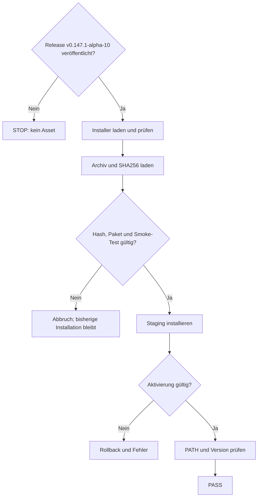

# 01 – Installation und Upgrade

## Gültigkeitsbereich

Diese Anleitung beschreibt den für `v0.147.1-alpha-10` vorgesehenen
Releasevertrag.

> **Hinweis:** Diese Installationsbefehle funktionieren nur, wenn der Tag
> `v0.147.1-alpha-10` den Release-Workflow erfolgreich durchlaufen hat und die
> Assets veröffentlicht sind. Andernfalls liefert die Release-URL
> erwartungsgemäß HTTP 404.

Die im Aufgabenwortlaut genannte Version `v0.141.1-alpha-10` widerspricht dem
Repository. Workspace, Branch und Releasefolge verwenden
`v0.147.1-alpha-10`; diese technisch belegte Version ist für alle Befehle
maßgeblich.

## Unterstützte Plattform und Voraussetzungen

Der Release-Workflow für Alpha‑10 baut ausschließlich für:

- Windows x64 (`x86_64-pc-windows-msvc`);
- Windows PowerShell 5.1 oder PowerShell 7;
- einen Benutzer mit Schreibrecht unter
  `%LOCALAPPDATA%\Programs\codex-extended-workflow`;
- Netzwerkzugriff auf GitHub und dessen API;
- bei einem privaten Repository zusätzlich ein leseberechtigtes `GH_TOKEN`
  oder `GITHUB_TOKEN`.

Git, Rust, Cargo und Node.js werden für die Installation des fertigen Pakets
nicht benötigt. Für die spätere Repository-Vorbereitung ist ein Git-Worktree
erforderlich. Anmeldung und Modellzugriff werden erst bei der Nutzung der CLI
benötigt.

Der Alpha‑10-Releasevertrag enthält weder ein Linux-/macOS-Releasepaket noch
einen projektspezifischen Bash-Installer. Die im Hauptprojekt vorhandenen
allgemeinen Shell-Installer gehören zum normalen Codex-Releaseweg und dürfen
nicht als Installer für `codex-extended-workflow` ausgegeben werden.

## Veröffentlichte Assets

Ein erfolgreicher Alpha‑10-Release muss genau diese projektspezifischen Assets
enthalten:

```text
codex-extended-workflow-package-x86_64-pc-windows-msvc.zip
codex-extended-workflow-package_SHA256SUMS
install-extended-workflow.ps1
```

Das Archiv enthält mindestens:

```text
bin\codex-extended-workflow.exe
bin\codex-code-mode-host.exe
codex-path\rg.exe
codex-resources\codex-command-runner.exe
codex-resources\codex-windows-sandbox-setup.exe
codex-package.json
```

Ein bloßes `cargo install` ist kein vollständiger Installationsweg. Es stellt
den separat gebauten Code Mode Host und die übrigen Paketressourcen nicht als
geprüfte Einheit bereit.

Das Repository enthält außerdem
`scripts/install/install-code-mode-host.ps1`. Dieses Skript ist ausdrücklich
nur ein versionsgebundener Reparaturhelfer für eine alte Alpha‑5-
Einzelbinärinstallation. Es ist weder der Alpha‑10-Installer noch ein
allgemeiner Upgradepfad und wird für Alpha‑10 nicht verwendet.

## Installation mit PowerShell

Der Installer kann aus jedem lokalen Ordner geladen und gestartet werden. Der
exakte Tag wird sowohl in der Download-URL als auch über `-Release` gebunden:

```powershell
$tag = "v0.147.1-alpha-10"
$installer = Join-Path $env:TEMP "install-extended-workflow.ps1"

Invoke-WebRequest `
    -Uri "https://github.com/mikmann/own-codex/releases/download/$tag/install-extended-workflow.ps1" `
    -OutFile $installer

& $installer -Release $tag
```

Bei einem privaten Repository verwendet der Installer automatisch ein bereits
gesetztes `GH_TOKEN` oder `GITHUB_TOKEN`. Der Token darf nicht in die
Dokumentation, Kommandohistorie oder Projektkonfiguration geschrieben werden.

Der Standard-Zielpfad lautet:

```text
%LOCALAPPDATA%\Programs\codex-extended-workflow
```

Der Installer ergänzt den Benutzer-`PATH` und den `PATH` der aktuellen
PowerShell-Sitzung. `-NoPathUpdate` unterbindet diese Änderung. Ein abweichender
verwalteter Zielpfad kann über `-InstallRoot <Pfad>` angegeben werden.

## Sicherheits- und Integritätsprüfungen

Vor dem Austausch einer vorhandenen Installation führt der Installer folgende
Prüfungen aus:

1. GitHub muss genau ein Archiv und genau ein Prüfsummenmanifest mit den
   erwarteten Namen liefern.
2. Der SHA‑256-Wert des vollständigen ZIP-Archivs muss dem Manifest
   entsprechen.
3. `codex-package.json`, Zielplattform, Variante und Paketstruktur müssen
   zusammenpassen.
4. Die CLI muss exakt die Paketversion melden.
5. `codex-code-mode-host.exe --help` muss erfolgreich sein.
6. Eine vorhandene Installation darf nur ersetzt werden, wenn sie sich selbst
   als verwaltete Extended-Workflow-Installation ausweist.
7. Der Austausch erfolgt über Staging und Backup; bei einem Fehler wird die
   vorherige Installation wiederhergestellt.

Das direkte Ausführen eines heruntergeladenen Skripts ist eine
Vertrauensentscheidung. Vor der Ausführung kann der Inhalt mit
`Get-Content -LiteralPath $installer` geprüft werden. Die Paketintegrität wird
anschließend durch das veröffentlichte SHA‑256-Manifest geprüft; der im
Alpha‑10-Quellstand enthaltene Release-Workflow erzeugt keine zusätzliche
Signatur.

## Installation verifizieren

Nach der Installation gelten diese Befehle als lokale Verifikation:

```powershell
Get-Command codex-extended-workflow | Format-List Source
codex-extended-workflow --version
codex-extended-workflow --help
codex-extended-workflow doctor
```

Für Alpha‑10 muss die Versionsausgabe lauten:

```text
codex-extended-workflow v0.147.1-alpha-10
```

`Get-Command` muss auf die beabsichtigte verwaltete Installation zeigen. Eine
abweichende Ausgabe belegt lediglich, dass eine andere Binärdatei früher im
`PATH` liegt.

## Manueller Download

Der alternative Browserweg besteht aus folgenden Schritten:

1. `https://github.com/mikmann/own-codex` wird geöffnet.
2. Im Bereich **Releases** wird `v0.147.1-alpha-10` ausgewählt.
3. Die drei oben genannten Assets werden in dasselbe lokale Verzeichnis
   heruntergeladen.
4. Der Installer wird mit den lokalen Paketpfaden gestartet:

   ```powershell
   & .\install-extended-workflow.ps1 `
       -ArchivePath .\codex-extended-workflow-package-x86_64-pc-windows-msvc.zip `
       -ChecksumPath .\codex-extended-workflow-package_SHA256SUMS
   ```

5. Danach werden `Get-Command`, `--version`, `--help` und `doctor` wie oben
   ausgeführt.

Das Archiv soll nicht manuell über eine bestehende Installation kopiert
werden. Der Installer prüft das Paket und führt den austauschbaren
Staging-Schritt aus.

## Upgrade von einer älteren Alpha-Version

Ein Upgrade benötigt keine vorherige Deinstallation. Derselbe Installer wird
mit dem neuen exakten Tag erneut ausgeführt:

```powershell
$tag = "v0.147.1-alpha-10"
$installer = Join-Path $env:TEMP "install-extended-workflow.ps1"
Invoke-WebRequest `
    -Uri "https://github.com/mikmann/own-codex/releases/download/$tag/install-extended-workflow.ps1" `
    -OutFile $installer
& $installer -Release $tag
codex-extended-workflow --version
```

Die verwalteten Programmdateien werden ersetzt. Konfiguration, Anmeldung,
Sitzungen, Logs und SQLite-Zustand unter
`%USERPROFILE%\.codex-extended-workflow` liegen außerhalb des
Installationsverzeichnisses und bleiben erhalten. Eine neue Shell ist nur dann
nötig, wenn eine bereits offene Anwendung noch eine alte `PATH`-Auflösung
verwendet; der Installer aktualisiert die aufrufende PowerShell-Sitzung bereits
direkt.

## Anmeldung und erster Start

```powershell
codex-extended-workflow login
codex-extended-workflow
```

Ohne `--shared-state` verwendet die CLI standardmäßig den isolierten Zustand:

```text
%USERPROFILE%\.codex-extended-workflow
```

Normales Codex verwendet standardmäßig `%USERPROFILE%\.codex`. Die Trennung
verhindert eine unbeabsichtigte gemeinsame Nutzung von Sitzungen und lokalen
Daten; sie ist keine Sicherheitsgrenze gegenüber anderen Prozessen desselben
lokalen Benutzers.

## Installations- und Upgrade-Workflow

### ASCII

```text
[Release v0.147.1-alpha-10 veröffentlicht?]
                 |
          +------+------+
          |             |
        Nein            Ja
          |             |
 [STOP: kein Asset]     v
                 [Installer laden/prüfen]
                           |
                           v
                 [Archiv + SHA256 laden]
                           |
                           v
                 <Hash/Paket/Smoke gültig?>
                    |                 |
                  Nein               Ja
                    |                 |
          [ABBRUCH, Altstand]         v
                              [Staging installieren]
                                      |
                                      v
                              <Aktivierung gültig?>
                                 |            |
                               Nein          Ja
                                 |            |
                      [Rollback + Fehler]     v
                                      [PATH + Version prüfen]
                                               |
                                               v
                                             [PASS]
```

### Mermaid



Beide Diagramme zeigen denselben Ablauf: Ein fehlender Release stoppt vor dem
Download, fehlerhafte Assets stoppen vor dem Austausch und eine fehlerhafte
Aktivierung führt zum Rollback.

## Fehlerbehebung

| Meldung oder Symptom | Bedeutung | Maßnahme |
| --- | --- | --- |
| HTTP 404 beim Installer-Download | Tag oder Asset ist nicht veröffentlicht | Schreibweise und GitHub-Release prüfen; ohne sichtbare Alpha‑10-Assets stoppen |
| `No published release was found` | Das Repository lieferte keinen sichtbaren, nicht als Draft markierten Release | Repositoryzugriff und gegebenenfalls `GH_TOKEN`/`GITHUB_TOKEN` prüfen; bevorzugt den exakten `-Release`-Wert verwenden |
| `must contain exactly one ... asset` | Release ist unvollständig oder falsch paketiert | Release nicht installieren; Release-Workflow korrigieren |
| `Package SHA-256 mismatch` | Archiv und Manifest gehören nicht zusammen oder der Download ist beschädigt | Dateien löschen, erneut laden und bei Wiederholung stoppen |
| Ausführung von Skripts ist deaktiviert | Lokale PowerShell-Richtlinie blockiert die Datei | Zulässige Organisationsrichtlinie beachten; gegebenenfalls nur für diesen Prozess `Set-ExecutionPolicy -Scope Process Bypass` verwenden |
| Befehl nicht gefunden | `PATH` enthält den verwalteten `bin`-Ordner noch nicht | neue PowerShell öffnen oder den vom Installer gemeldeten Pfad prüfen |
| Falsche Version wird ausgeführt | Ein älterer Pfad steht vor der verwalteten Installation | alle Treffer mit `Get-Command codex-extended-workflow -All` prüfen und `PATH` korrigieren |
| Code Mode Host fehlt | unvollständige oder manuelle CLI-Installation | das vollständige Releasepaket erneut über den Installer installieren |
| Datenbankmigration schlägt fehl | lokaler Zustand ist nicht mit der gestarteten Binärdatei kompatibel | zunächst `doctor` ausführen; keine Datenbankdatei ohne Sicherung löschen |

Weitere Laufzeitdiagnosen stehen in
[06 – Bedienung und Fehlerbehebung](06-bedienung-und-fehlerbehebung.md).

## Nächster Schritt

Nach erfolgreicher Installation folgt
[02 – Schnellstart und Repository-Vorbereitung](02-schnellstart-und-vorbereitung.md).
