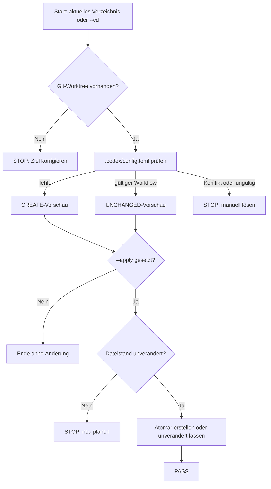

# 02 – Schnellstart und Repository-Vorbereitung

## Was ein Repository benötigt

Für den erweiterten Workflow genügt grundsätzlich diese projektlokale Datei:

```text
<Repository>\
└── .codex\
    └── config.toml
```

Eine zusätzliche `AGENTS.md` oder ein Verzeichnis `.codex/agents` ist für den
Standard-Workflow nicht erforderlich. Eigene Workflow-Rollen benötigen dagegen
eine `[agents.<name>]`-Definition und bei dateibasierten Anweisungen eine
vertrauenswürdige Rollendatei, typischerweise unter `.codex/agents`. Diese
Dateien entstehen nicht automatisch, weil ihre fachlichen Inhalte
projektspezifisch sind.

Projektlokale Konfiguration wird nur in einem von Codex als vertrauenswürdig
behandelten Repository geladen. Sicherheitsrelevante oder nicht unterstützte
Schlüssel können projektlokal ignoriert werden und gehören dann in die globale
Benutzerkonfiguration.

## Sichere Vorbereitung in zwei Schritten

Zunächst wird in den Git-Worktree gewechselt:

```powershell
Set-Location D:\Pfad\zum\Repository
```

Zuerst nur die geplante Aktion anzeigen:

```powershell
codex-extended-workflow prepare-extend-workflow
```

Nach Prüfung der Vorschau wird derselbe Plan angewendet:

```powershell
codex-extended-workflow prepare-extend-workflow --apply
```

Ohne `--apply` werden keine Dateien verändert. Beim Anwenden wird eine fehlende
`.codex/config.toml` vollständig erstellt. Die Alpha‑10-Vorlage setzt
`extended_workflow.workflow_type = "auto"`, benennt Experten- und
Reviewerprofile samt Modell und Reasoning-Stufe und fügt lokale
`selection_keywords` hinzu.

## Vorbereitung aus einem beliebigen Ordner

Mit `--cd` oder der Kurzform `-C` kann das Ziel explizit angegeben werden:

```powershell
codex-extended-workflow prepare-extend-workflow --cd D:\Pfad\zum\Repository
codex-extended-workflow prepare-extend-workflow --cd D:\Pfad\zum\Repository --apply
```

Das Ziel muss ein Git-Worktree sein. Andernfalls endet die Vorschau bewusst mit:

```text
not inside a Git worktree; run this command from a repository or pass --cd <DIR>
```

## Verhalten bei vorhandener Konfiguration

`prepare-extend-workflow` überschreibt keine vorhandene Konfiguration:

| Ausgangslage | Ergebnis |
| --- | --- |
| `.codex/config.toml` fehlt | vollständige Vorlage wird geplant bzw. erstellt |
| gültiger `[extended_workflow]`-Abschnitt vorhanden | Datei wird unverändert wiederverwendet |
| Datei vorhanden, aber Abschnitt fehlt | Konflikt; Abschnitt muss manuell ergänzt werden |
| `extended_workflow.enabled = false` | Konflikt; bewusste Deaktivierung wird nicht überschrieben |
| Datei ist ungültiges TOML | Konflikt; zuerst Syntax korrigieren |

Die Vorschau ist an den geprüften Dateistand gebunden. Wird die Datei zwischen
Vorschau und Anwendung verändert, bricht die Anwendung geschlossen ab und muss
neu gestartet werden.

## Globale Standardkonfiguration

Wenn die Konfiguration für alle Repositories gelten soll, kann sie im isolierten
Benutzerbereich der erweiterten CLI vorbereitet werden:

```powershell
codex-extended-workflow prepare-extend-workflow --global
codex-extended-workflow prepare-extend-workflow --global --apply
```

Projektlokale Einstellungen können globale Einstellungen für das jeweilige
vertrauenswürdige Repository überschreiben. CLI-Argumente haben wiederum
Vorrang vor den Konfigurationsdateien.

## Entsprechende TUI-Befehle

In einer laufenden interaktiven Sitzung stehen dieselben Varianten als
Slash-Befehle zur Verfügung:

```text
/prepare-extend-workflow
/prepare-extend-workflow apply
/prepare-extend-workflow global
/prepare-extend-workflow global apply
```

## Ersten Workflow starten

Im vorbereiteten Projekt:

```powershell
codex-extended-workflow
```

Mit Alpha‑10 kann ein Arbeitsauftrag ausdrücklich erzwungen werden:

```powershell
codex-extended-workflow --workflow-type work-order
```

Beispielauftrag:

```text
Analysiere die bestehende Importfunktion, erstelle ein umsetzbares Ticket mit
Akzeptanzkriterien, implementiere es und prüfe die Änderung vollständig.
```

Die CLI klassifiziert die Anfrage lokal, zieht bei einem Arbeitsauftrag die
passenden Experten hinzu, lässt den Hauptagenten das Ticket umsetzen und startet
anschließend den Reviewer-Prozess.

## Sitzung fortsetzen

```powershell
$sessionId = "<SITZUNGS-ID>"
codex-extended-workflow resume $sessionId
```

Wurde die Sitzung ausdrücklich mit normalem Codex-State gestartet:

```powershell
$sessionId = "<SITZUNGS-ID>"
codex-extended-workflow --shared-state resume $sessionId
```

Das Produktpräfix bleibt damit auch im angezeigten Resume-Befehl eindeutig.

## Vorbereitungsworkflow

### ASCII

```text
[Start: aktuelles Verzeichnis oder --cd]
                  |
                  v
          <Git-Worktree vorhanden?>
             |                |
           Nein               Ja
             |                |
   [STOP: Ziel korrigieren]    v
                       [.codex/config.toml prüfen]
                              |
          +-------------------+-------------------+
          |                   |                   |
       fehlt          gültiger Workflow      Konflikt/ungültig
          |                   |                   |
 [CREATE-Vorschau]   [UNCHANGED-Vorschau]   [STOP: manuell lösen]
          |                   |
          +---------+---------+
                    |
             <-- ohne --apply --> [ENDE: keine Änderung]
                    |
              mit --apply
                    |
                    v
           <Dateistand unverändert?>
              |               |
            Nein              Ja
              |               |
       [STOP: neu planen]      v
                         [atomar erstellen
                          oder unverändert lassen]
                                  |
                                  v
                                [PASS]
```

### Mermaid



Beide Diagramme bilden dieselben Fail-closed-Grenzen ab: Ohne Git-Worktree,
bei Konflikten oder nach einer Änderung zwischen Vorschau und Anwendung wird
nichts geschrieben.

## Nächster Schritt

Der vollständige Ablauf ist in [03 – Workflow](03-workflow.md) dargestellt.
Eigene Rollen werden in
[08 – Konfigurierbare Workflow-Rollen](08-konfigurierbare-workflow-rollen.md)
beschrieben.
