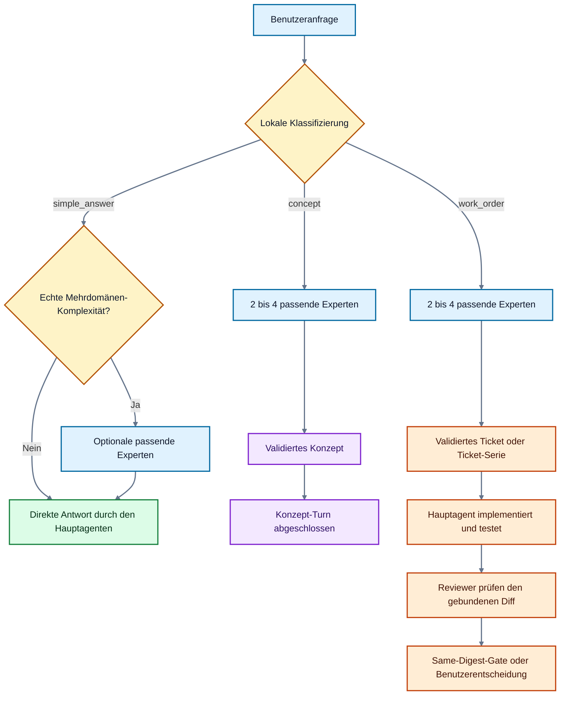

# 03 – Der erweiterte Workflow

## Grundidee

Der Workflow trennt Beratung, Umsetzung und Prüfung in klar erkennbare Phasen:

- **Experten** beraten den Hauptagenten bei Konzepten, Entscheidungen und
  Tickets.
- **Der Hauptagent** integriert die Ergebnisse und ist der einzige Agent, der
  Änderungen umsetzt.
- **Reviewer** prüfen die tatsächliche Änderung unabhängig und ausschließlich
  lesend.
- **Der Validator** prüft zusätzlich, ob die strukturierten Antworten formal,
  inhaltlich und zur gebundenen Aufgabe passend sind.

Die Anfrage wird lokal und deterministisch klassifiziert. Dafür wird kein
zusätzlicher Modellaufruf verbraucht.

## Ablaufdiagramme in Mermaid und ASCII

Der Gesamtprozess ist bewusst auf zwei inhaltliche Diagramme verteilt. Ein einzelner Graph
mit allen drei Klassen, Korrekturschleifen und Rücksprüngen erzeugt bei Mermaid
ein sehr hohes, schlecht lesbares Layout. Das erste Diagramm zeigt die
Klassifizierung; das zweite zeigt den vollständigen Arbeitsauftrag einschließlich
Same-Digest-Abschluss. Jede Sicht steht zuerst als Mermaid-Diagramm und direkt
darunter mit derselben Logik als reine ASCII-Fassung.

### Klassifizierung und Hauptpfade



### Klassifizierung und Hauptpfade als ASCII

```text
[BENUTZERANFRAGE]
        |
        v
{LOKALE KLASSIFIZIERUNG}
        |
        +-- simple_answer --> {ECHTE MEHRDOMÄNEN-KOMPLEXITÄT?}
        |                           |
        |                           +-- Nein --> [DIREKTE ANTWORT]
        |                           |
        |                           +-- Ja --> [OPTIONALE PASSENDE EXPERTEN]
        |                                          |
        |                                          v
        |                                   [DIREKTE ANTWORT]
        |
        +-- concept --------> [2 BIS 4 PASSENDE EXPERTEN]
        |                           |
        |                           v
        |                    [VALIDIERTES KONZEPT]
        |                           |
        |                           v
        |                    [KONZEPT-TURN FERTIG]
        |
        +-- work_order -----> [2 BIS 4 PASSENDE EXPERTEN]
                                    |
                                    v
                             [VALIDIERTES TICKET
                              ODER TICKET-SERIE]
                                    |
                                    v
                             [HAUPTAGENT IMPLEMENTIERT
                              UND TESTET]
                                    |
                                    v
                             [REVIEWER PRÜFEN DEN
                              GEBUNDENEN DIFF]
                                    |
                                    v
                             [SAME-DIGEST-GATE ODER
                              BENUTZERENTSCHEIDUNG]
```

### Arbeitsauftrag mit Reviewer- und Same-Digest-Gate

```mermaid
flowchart TD
    A["1 · Arbeitsauftrag"] --> B["2 · Zwei bis vier passende Experten<br/>beraten read-only"]
    B --> C{"Expertenberichte<br/>formal und inhaltlich gültig?"}
    C --> C1["Gültig:<br/>Experten-Gate erfüllt"]
    C --> C2["Ungültig:<br/>genau ein Korrekturversuch"]
    C2 --> C3{"Korrigierter Bericht gültig?"}
    C3 --> C1
    C3 --> Z1["Weiterhin ungültig:<br/>Workflow stoppt"]

    C1 --> D["3 · Konzept, falls verlangt, und<br/>aktuelles Ticket validieren"]
    D --> E["4 · Nur der Hauptagent<br/>implementiert und testet"]
    E --> F["5 · Finalen Working-Tree-Diff<br/>binärsensitiv hashen"]
    F --> G["6 · Zwei bis vier passende Reviewer<br/>prüfen exakt diesen Digest read-only"]
    G --> H{"Reviewerberichte formal gültig?"}
    H --> H1["Gültig:<br/>inhaltliches Review auswerten"]
    H --> H2["Ungültig:<br/>genau ein Format-Korrekturversuch"]
    H2 --> H3{"Korrigierter Bericht gültig?"}
    H3 --> H1
    H3 --> Z1

    H1 --> I{"PASS und leere Befundliste?"}
    I --> I1["PASS:<br/>Reviewer-Nachweis ist zulässig"]
    I --> J["Befunde vorhanden:<br/>Auflösung nach Schweregrad"]
    J --> J1["High oder Critical:<br/>zwingend beheben"]
    J --> J2["Low oder Medium:<br/>beheben oder konkret disponieren"]
    J1 --> K["Code korrigieren<br/>und Tests erneut ausführen"]
    J2 --> K
    J2 --> L["Konkrete Disposition<br/>ohne Diff-Änderung"]
    K --> M["Diff geändert:<br/>neuer Digest und neue Reviewrunde"]
    L --> N["Derselbe Reviewer liefert<br/>genau eine Re-Review-Ausgabe"]
    N --> O{"Befunde geschlossen?"}
    O --> I1
    O --> Z2["Weiterhin offen:<br/>Benutzerentscheidung erforderlich"]

    I1 --> P["7 · Aktuellen Working-Tree-Digest<br/>beim Abschluss erneut berechnen"]
    P --> Q{"Alle benötigten Rollen PASS<br/>auf demselben aktuellen Digest?"}
    Q --> X["Workflow erfolgreich abgeschlossen"]
    Q --> Y["Nachweis fehlt oder ist veraltet:<br/>neue Reviewrunde oder Benutzerentscheidung"]

    classDef step fill:#e0f2fe,stroke:#0369a1,color:#0f172a,stroke-width:2px;
    classDef gate fill:#fef3c7,stroke:#b45309,color:#0f172a,stroke-width:2px;
    classDef good fill:#dcfce7,stroke:#15803d,color:#052e16,stroke-width:2px;
    classDef warn fill:#ffedd5,stroke:#c2410c,color:#431407,stroke-width:2px;
    classDef stop fill:#fee2e2,stroke:#b91c1c,color:#450a0a,stroke-width:2px;

    class A,B,D,E,F,G,K,L,M,N,P step;
    class C,C3,H,H3,I,O,Q gate;
    class C1,H1,I1,X good;
    class C2,H2,J,J1,J2,Y warn;
    class Z1,Z2 stop;
    linkStyle default stroke:#64748b,stroke-width:2px;
```



### Arbeitsauftrag mit Reviewer- und Same-Digest-Gate als ASCII

```text
[1. ARBEITSAUFTRAG]
          |
          v
[2. 2 BIS 4 PASSENDE EXPERTEN BERATEN READ-ONLY]
          |
          v
{SIND ALLE EXPERTENBERICHTE VOLLSTÄNDIG GÜLTIG?}
          |
          +-- Nein --> [genau ein gezielter Korrekturversuch]
          |                         |
          |                         v
          |             {KORRIGIERTER BERICHT GÜLTIG?}
          |                         |
          |                         +-- Nein --> [STOP]
          |                         |
          |                         +-- Ja ------+
          |                                      |
          +-- Ja --------------------------------+
                                                 |
                                                 v
[3. KONZEPT, FALLS VERLANGT, UND AKTUELLES TICKET VALIDIEREN]
          |
          v
[4. NUR DER HAUPTAGENT IMPLEMENTIERT UND TESTET]
          |
          v
[5. FINALEN WORKING-TREE-DIFF BINÄRSENSITIV HASHEN]
          |
          v
[6. 2 BIS 4 REVIEWER PRÜFEN EXAKT DIESEN DIGEST READ-ONLY]
          |
          v
{SIND ALLE REVIEWERBERICHTE FORMAL GÜLTIG?}
          |
          +-- Nein --> [genau ein Format-Korrekturversuch]
          |                         |
          |                         v
          |             {KORRIGIERTER BERICHT GÜLTIG?}
          |                         |
          |                         +-- Nein --> [STOP]
          |                         |
          |                         +-- Ja ------+
          |                                      |
          +-- Ja --------------------------------+
                                                 |
                                                 v
{VERDICT = PASS UND BEFUNDLISTE LEER?}
          |
          +-- Ja --> [Reviewer-Nachweis ist zulässig] ----------------+
          |                                                            |
          +-- Nein --> [BEFUNDE NACH SCHWERE AUFLÖSEN]                 |
                             |                                         |
                             +-- High/Critical --> zwingend beheben     |
                             |              |                           |
                             +-- Low/Medium -----> beheben              |
                             |              |                           |
                             |              v                           |
                             |     [Tests + neuer Diff-Digest]          |
                             |              |                           |
                             |              +--> [neue Reviewrunde]     |
                             |                     zurück zu Schritt 6  |
                             |                                          |
                             +-- Low/Medium --> konkrete Disposition    |
                                            ohne Diff-Änderung          |
                                                   |                    |
                                                   v                    |
                                      [derselbe Reviewer: eine Re-Review]
                                                   |                    |
                                                   v                    |
                                      {BEFUNDE GESCHLOSSEN?}            |
                                                   |                    |
                                                   +-- Nein -->         |
                                                   |   [Benutzer-       |
                                                   |    entscheidung]   |
                                                   |                    |
                                                   +-- Ja --------------+
                                                                        |
                                                                        v
[7. AKTUELLEN WORKING-TREE-DIGEST BEIM ABSCHLUSS ERNEUT BERECHNEN]
          |
          v
{ALLE BENÖTIGTEN REVIEWERROLLEN PASS AUF DEMSELBEN AKTUELLEN DIGEST?}
          |
          +-- Ja   --> [WORKFLOW ERFOLGREICH ABGESCHLOSSEN]
          |
          +-- Nein --> [neue Reviewrunde oder Benutzerentscheidung]
```

## Phase 1: Anfrage binden und klassifizieren

Die unveränderliche Aufgabenbindung verhindert, dass ein späterer Experte oder
Reviewer an einer anderen Fragestellung arbeitet. Kurze Fortsetzungen wie
`ja`, `weiter` oder `Option 1` werden mit dem vorherigen Arbeitskontext
verbunden. Ist die Fortsetzung nicht eindeutig, muss der Workflow nachfragen
oder geschlossen stoppen.

Die Klassen haben folgende Wirkung:

| Klasse | Typischer Ablauf |
|---|---|
| Einfache Antwort (`simple_answer`) | Hauptagent antwortet direkt; Experten nur bei echter zusätzlicher Komplexität |
| Konzept (`concept`) | Experten beraten; Hauptagent erstellt ein validiertes Konzept, optional danach Tickets |
| Arbeitsauftrag (`work_order`) | Experten beraten; Hauptagent erstellt ein oder mehrere umsetzbare Tickets |

## Konkrete Alpha‑9-Beispiele für die drei Klassen

Die Klassifizierung folgt dem Inhalt und der gewünschten Aktion, nicht nur
einzelnen Schlüsselwörtern. Die folgenden Beispiele zeigen den erwarteten
Ablauf von `v0.147.1-alpha-9` bei aktivierter Standardkonfiguration.

### Beispiel 1: Einfache Antwort (`simple_answer`)

Benutzerprompt:

```text
Erkläre mir kurz den Unterschied zwischen `git fetch` und `git pull`.
Ändere keine Dateien.
```

Erwarteter Ablauf:

1. Die lokale Klassifizierung ergibt `simple_answer`.
2. Der Hauptagent beantwortet die Frage direkt.
3. Da die Frage nur ein klar begrenztes Fachgebiet betrifft, werden keine
   Experten benötigt.
4. Es wird weder ein Konzept noch ein Ticket erzeugt.
5. Da keine Arbeitsänderung beauftragt wurde, ist kein Reviewer-Gate
   erforderlich.

Bei einer einfachen Frage, die dennoch mehrere unabhängige Fachgebiete oder ein
erhöhtes Risiko berührt, darf der Hauptagent passende Experten hinzuziehen. Die
Klasse bleibt trotzdem `simple_answer`, solange weder ein Konzept noch eine
Umsetzung verlangt wird.

### Beispiel 2: Konzept (`concept`)

Benutzerprompt:

```text
Erstelle ein technisches Konzept für einen revisionssicheren Dokumentenimport
mit Virenprüfung, Dublettenerkennung und nachvollziehbarer Fehlerbehandlung.
Noch nichts implementieren und noch keine Dateien ändern.
```

Erwarteter Ablauf:

1. Die lokale Klassifizierung ergibt `concept`.
2. Standardmäßig werden zwei bis vier passende Experten ausgewählt, zum
   Beispiel Architektur, Sicherheit sowie Testing und Kompatibilität.
3. Jeder Experte liefert einen vollständigen strukturierten Bericht. Ungültige
   Berichte erhalten höchstens einen gezielten Korrekturversuch.
4. Der Hauptagent integriert die akzeptierten Beiträge in ein strukturiertes
   Konzept mit Zielbild, Entscheidungen, Risiken und offenen Punkten.
5. Das Konzept wird als Workflow-Artefakt validiert.
6. Der Konzept-Turn ist damit abgeschlossen. Eine Implementierung beginnt erst,
   wenn der Benutzer daraus ausdrücklich einen Arbeitsauftrag macht.

Optional kann das Konzept bereits validierte Ticketvorschläge enthalten. Diese
werden aber in einem reinen Konzept-Turn nicht automatisch implementiert.

### Beispiel 3: Arbeitsauftrag (`work_order`)

Benutzerprompt:

```text
Implementiere für den Dokumentenimport ein konfigurierbares Request-Timeout.
Erstelle zuerst ein umsetzbares Ticket mit Akzeptanzkriterien, ändere den Code,
ergänze passende Tests und prüfe die fertige Änderung vollständig.
```

Erwarteter Ablauf:

1. Die lokale Klassifizierung ergibt `work_order`.
2. Zwei bis vier zur Änderung passende Experten beraten den Hauptagenten.
3. Der Hauptagent erstellt mindestens ein validiertes Ticket mit
   Akzeptanzkriterien und Prüfschritten. Bei mehreren Tickets wird genau ein
   aktuelles Ticket ausgewählt.
4. Nur der Hauptagent verändert den Working Tree und führt die relevanten Tests
   aus.
5. Aus dem finalen binärsensitiven Working-Tree-Diff wird ein Digest gebildet.
6. Zwei bis vier fachlich unterschiedliche Read-only-Reviewer prüfen exakt
   diesen Digest.
7. Low- und Medium-Befunde werden behoben oder konkret disponiert und erneut
   geprüft. High- und Critical-Befunde müssen behoben werden.
8. Ändert eine Korrektur den Diff, wird eine neue Reviewrunde an den neuen
   Digest gebunden.
9. Der Workflow ist erst abgeschlossen, wenn alle benötigten Reviewerrollen auf
   demselben aktuellen Digest gültig mit PASS und leerer Befundliste vorliegen.

## Phase 2: Expertenprozess

Der Hauptagent wählt abhängig von den betroffenen Fachgebieten zwischen dem
konfigurierten Minimum und Maximum passende Expertenprofile aus. Standardmäßig
sind das mindestens zwei und höchstens vier.

Ein Expertenbeitrag muss:

- zur gebundenen Anfrage und zur zugewiesenen Rolle passen,
- eine vollständige, fachlich verwertbare Antwort liefern,
- dem erwarteten strukturierten Datenvertrag entsprechen,
- innerhalb des Ergebnis- und Kontextlimits bleiben.

Bei einem ungültigen Bericht erhält derselbe Agent genau einen
Korrekturversuch. Ein formal ungültiger Bericht bedeutet nicht automatisch,
dass seine fachliche Schlussfolgerung falsch war; er kann beispielsweise am
Schema, an fehlender Evidenz oder an einer unklaren Aufgabenbindung scheitern.

## Phase 3: Konzept, Ticket und Implementierung

Der Hauptagent fasst die gültigen Expertenbeiträge zusammen. Bei einem
Arbeitsauftrag entstehen daraus Tickets mit eindeutigem Gegenstand,
Akzeptanzkriterien und Prüfschritten. Anschließend setzt nur der Hauptagent das
aktuelle Ticket um.

Experten und Reviewer dürfen nicht parallel eigene Varianten in den
Arbeitsbaum schreiben. Diese Trennung verhindert konkurrierende Änderungen und
macht die spätere Prüfung eindeutig.

## Phase 4: Reviewer-Prozess

Nach der Umsetzung wird aus dem tatsächlichen, binärsensitiven Arbeitsbaum ein
Digest gebildet. Erst dann wählt der Hauptagent passende, voneinander
verschiedene Reviewer-Rollen. Jeder Reviewer erhält denselben gebundenen Stand
und arbeitet read-only.

Ein Reviewer-PASS ist nur gültig, wenn:

1. der Bericht strukturell valide ist,
2. die Aufgaben- und Digest-Bindung stimmt,
3. `verdict` auf `pass` steht,
4. die Liste der Befunde leer ist.

Ändert sich der Arbeitsbaum nach einem Review, ist der alte PASS nicht mehr der
Abschlussnachweis. Für den neuen Digest ist eine neue gebundene Reviewrunde
erforderlich.

## Befunde und Schweregrade

Reviewer beschreiben Befunde anhand von Auswirkung, Eintrittswahrscheinlichkeit
und Wiederherstellbarkeit. Daraus wird der Schweregrad konsistent abgeleitet:

| Punkte | Schweregrad | Bedeutung für den Workflow |
|---:|---|---|
| 0–2 | Low | muss behoben oder ausdrücklich disponiert und erneut geprüft werden |
| 3–4 | Medium | muss behoben oder ausdrücklich disponiert und erneut geprüft werden |
| 5–6 | High | releasekritisch; muss behoben und erneut geprüft werden |
| 7–9 | Critical | releasekritisch; muss behoben und erneut geprüft werden |

Auch Low- und Medium-Befunde werden nicht stillschweigend ignoriert. Bei einer
begründeten Disposition ohne Diff-Änderung liefert derselbe Reviewer eine neue
Ausgaberevision und prüft sie einmal erneut. Verändert eine Fehlerkorrektur den
Working Tree, ist der bisherige Reviewerplan nicht mehr aktuell: Die CLI bindet
eine neue Reviewrunde an den neuen Digest, und alle für den Abschluss benötigten
Rollen müssen gültige Nachweise für diesen Stand liefern. Bleibt ein Befund nach
der zulässigen Re-Review offen, endet die automatische Schleife und der Benutzer
muss entscheiden.

## Sichtbare Agenten- und Reviewausgabe

Die TUI zeigt jeden ausgewählten Agenten in einer kompakten Zeile:

```text
reviewer_3: Reviewer | Testing and regression | gpt-5.5 | high | PASS
```

Dabei werden Name, Typ, Rolle, Modell, Reasoning-Stärke und Status getrennt
dargestellt. Farben unterstützen die Orientierung; der Text bleibt jedoch die
verbindliche Information, etwa bei `NO_COLOR` oder in einem Terminal ohne
Farbfähigkeit.

Typische Statusinformationen sind:

- `Validated` oder `PASS`: formal gültig und verwertbar
- `Needs resolution`: Befund muss bearbeitet oder disponiert werden
- `Rejected` oder `Invalid`: Bericht hat den Daten- oder Bindungsvertrag nicht erfüllt
- `Low`, `Medium`, `High`, `Critical`: maximaler Schweregrad eines Befunds

## Abschluss-Gate

Ein Arbeitsworkflow ist erst erfolgreich abgeschlossen, wenn alle ausgewählten
Reviewer auf demselben aktuellen Digest gültig mit PASS und ohne Befunde
geantwortet haben. Ein laufender Test, ein Commit oder ein einzelner grüner
Reviewer ersetzt dieses gemeinsame Gate nicht.

Weiter mit [04 – Konfiguration](04-konfiguration.md).
