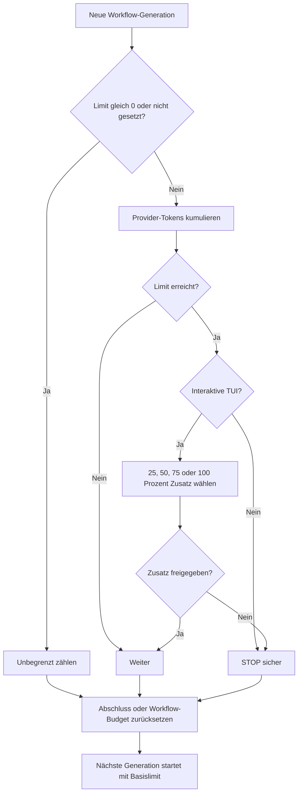

# 04 – Konfiguration

Für einen geführten Einstieg mit TOML-Grundlagen, Speicherorten, einer
kompakten gültigen Beispielkonfiguration und Abschlusscheck siehe
[07 – `.codex/config.toml`-Praxisanleitung](07-config-toml-praxisanleitung.md).

## Speicherorte und Vorrang

Die Konfiguration kann global oder projektlokal liegen:

| Ebene | Typischer Pfad | Zweck |
| --- | --- | --- |
| Global für die erweiterte CLI | `~/.codex-extended-workflow/config.toml` | persönliche Standardwerte |
| Projektlokal | `<Repository>/.codex/config.toml` | reproduzierbare Vorgaben des Projekts |
| CLI-Argument | beim aktuellen Aufruf | einmalige Überschreibung |

Vereinfacht gilt: CLI-Argumente überschreiben Projektwerte, Projektwerte
überschreiben globale Werte. Projektkonfiguration wird nur für ein
vertrauenswürdiges Repository berücksichtigt.

## Vollständige Standardvorlage

`prepare-extend-workflow --apply` erzeugt bei fehlender Datei diese wesentlichen
Einstellungen:

```toml
[extended_workflow]
enabled = true
workflow_type = "auto"
audit_mode = true
# 0 = unbegrenzt. Ein positiver Wert umfasst Hauptagent, Experten,
# Reviewer und Kompaktierungen zusammen.
workflow_budget_tokens = 0
max_result_bytes = 8192

[extended_workflow.experts]
enabled = true
min = 2
max = 4

[[extended_workflow.experts.profiles]]
name = "expert_1"
role = "Architecture"
selection_keywords = ["architecture", "architektur", "design", "module"]
model = "gpt-5.6-sol"
reasoning_effort = "high"

[[extended_workflow.experts.profiles]]
name = "expert_2"
role = "Orchestration and context"
selection_keywords = ["workflow", "orchestration", "context", "kontext"]
model = "gpt-5.6-terra"
reasoning_effort = "xhigh"

[[extended_workflow.experts.profiles]]
name = "expert_3"
role = "Security and permissions"
selection_keywords = ["security", "sicherheit", "permission", "berechtigung"]
model = "gpt-5.5"
reasoning_effort = "high"

[[extended_workflow.experts.profiles]]
name = "expert_4"
role = "Testing and compatibility"
selection_keywords = ["test", "testing", "regression", "compatibility", "kompatibilität"]
model = "gpt-5.6-sol"
reasoning_effort = "max"

[extended_workflow.reviewers]
enabled = true
min = 2
max = 4

[[extended_workflow.reviewers.profiles]]
name = "reviewer_1"
role = "Correctness and architecture"
selection_keywords = ["correctness", "korrektheit", "architecture", "architektur"]
model = "gpt-5.6-sol"
reasoning_effort = "high"

[[extended_workflow.reviewers.profiles]]
name = "reviewer_2"
role = "Security and permissions"
selection_keywords = ["security", "sicherheit", "permission", "berechtigung"]
model = "gpt-5.6-terra"
reasoning_effort = "xhigh"

[[extended_workflow.reviewers.profiles]]
name = "reviewer_3"
role = "Testing and regression"
selection_keywords = ["test", "testing", "regression", "quality", "qualität"]
model = "gpt-5.5"
reasoning_effort = "high"

[[extended_workflow.reviewers.profiles]]
name = "reviewer_4"
role = "Product and workflow compatibility"
selection_keywords = ["product", "produkt", "workflow", "compatibility", "kompatibilität"]
model = "gpt-5.6-sol"
reasoning_effort = "max"

[tui]
status_line = ["model-with-reasoning", "session-tokens", "workflow-tokens"]
status_line_use_colors = true
```

Die ausführbare Datei enthält Standardprofile, deren Modelle und
Reasoning-Stärken jedes Experten- und Reviewerprofil unabhängig überschreiben
kann. Das angegebene Modell muss in der aktiven Laufzeit verfügbar sein und die
gewählte Reasoning-Stärke unterstützen.

Die Schlüssel im Hauptabschnitt bedeuten:

| Schlüssel | Wirkung |
| --- | --- |
| `enabled` | schaltet die Klassifizierungs- und Workflowlogik ein oder aus |
| `workflow_type` | Startauswahl: `auto`, `inactive`, `concept` oder `work-order` |
| `audit_mode` | zeigt normale modell-sichtbare Workflowdiagnosen; erzeugt keine Auditdateien |
| `workflow_budget_tokens` | hartes kumulatives Tokenlimit für den aktiven Workflow |
| `max_result_bytes` | harte UTF‑8-Größe eines strukturierten Experten-, Reviewer-, Konzept- oder Ticketergebnisses |

## Keine host-review-receipts erforderlich

Dieser Workflow benötigt keine Verzeichnisse wie `host-review-receipts`, keine
`compose-prompts.mjs` und keine separat erzeugten Promptdateien. Auch
`audit_mode = true` schreibt solche Dateien nicht. Der gebundene
Validierungsstatus wird begrenzt im jeweils aktiven lokalen State geführt
(standardmäßig im isolierten Extended-Workflow-State); die vollständigen
Rohantworten werden dafür nicht nochmals als Repository-Artefakte dupliziert.

## Hauptagent separat konfigurieren

Die Profilwerte oben gelten nur für die jeweiligen Subagents. Das Modell des
Hauptagenten wird mit den normalen Codex-Schlüsseln festgelegt:

```toml
model = "gpt-5.6-sol"
model_reasoning_effort = "max"
```

Wichtig ist die unterschiedliche Schreibweise:

- Hauptagent: `model_reasoning_effort`
- Experten-/Reviewerprofil: `reasoning_effort`

## Experten und Reviewer unabhängig skalieren

Für beide Prozesse gilt:

```text
0 <= min <= max <= 6
```

`min` und `max` dürfen gleich sein. Damit kann beispielsweise immer exakt ein
Vierer-Review erzwungen werden:

```toml
[extended_workflow.reviewers]
enabled = true
min = 4
max = 4
```

Wenn ein Prozess aktiviert ist, dürfen nicht weniger unterschiedliche Profile
konfiguriert sein als sein `max`-Wert. Profilnamen und Rollen müssen innerhalb
des jeweiligen Prozesses eindeutig sein.

Der Hauptagent wählt innerhalb des Bereichs nicht einfach die ersten Profile,
sondern die zur konkreten Aufgabe passenden Fachrollen.

## Prozesse deaktivieren

Den gesamten Extended Workflow für neue Anfragen deaktiviert:

```toml
[extended_workflow]
workflow_type = "inactive"
```

Das lässt die normale Codex-Verarbeitung aktiv. `enabled = false` ist dagegen
der harte Konfigurationsschalter und erzwingt ebenfalls `inactive`; er kann
nicht mit `/workflow-type concept` oder `work-order` umgangen werden.

Die Auswahl kann in einer laufenden TUI mit `/workflow-type` geändert werden.
Sie wird im Thread gespeichert und gilt ab der nächsten Root-Anfrage. Während
eines aktiven Turns oder einer offenen Workflow-Generation wird ein Wechsel
abgewiesen. Details stehen in
[Konzept: Workflow-Typ und Statusausgaben](concepts/02-workflow-typ-und-statusausgaben.md).

Experten- und Reviewerprozess lassen sich unabhängig davon deaktivieren.

Dauerhaft in der Konfiguration:

```toml
[extended_workflow.experts]
enabled = false
min = 0
max = 0

[extended_workflow.reviewers]
enabled = false
min = 0
max = 0
```

Nur für einen Aufruf:

```powershell
codex-extended-workflow --disable-experts
codex-extended-workflow --disable-reviewers
codex-extended-workflow --disable-experts --disable-reviewers
```

Das Deaktivieren des Reviewer-Prozesses entfernt bewusst das automatische
Review-Abschluss-Gate. Es sollte deshalb nur für Aufgaben verwendet werden, bei
denen diese Qualitätsstufe nicht benötigt wird.

## Profile ersetzen oder erweitern

`profiles` ersetzt den eingebauten Katalog vollständig. `additional_profiles`
ergänzt dagegen den wirksamen Katalog. Der Katalog darf bis zu 16 Profile
enthalten; gleichzeitig ausgewählt werden weiterhin höchstens 6. Beispiel für
zwei zusätzliche Reviewerrollen:

```toml
[[extended_workflow.reviewers.additional_profiles]]
name = "performance"
role = "Performance and concurrency"
selection_keywords = ["performance", "concurrency", "parallelität"]
model = "gpt-5.6-terra"
reasoning_effort = "high"
context_budget = 32000

[[extended_workflow.reviewers.additional_profiles]]
name = "documentation"
role = "Documentation and user experience"
selection_keywords = ["documentation", "dokumentation", "manual", "anleitung"]
model = "gpt-5.6-sol"
reasoning_effort = "high"
context_budget = 24000
```

Danach kann `max` auf höchstens `6` angehoben werden. Alle Felder eines Profils:

| Feld | Wirkung |
| --- | --- |
| `name` | eindeutiger Anzeigename |
| `role` | eindeutige fachliche Rolle und Aufgabenbindung |
| `agent_type` | optionaler Verweis auf eine bestehende `[agents.<name>]`-Definition |
| `selection_keywords` | lokale Wörter oder Wortfolgen für die deterministische Auswahl; keine Rollenanweisung, Treffer können aber in der begrenzten Plandiagnose erscheinen |
| `model` | Modell für dieses Profil |
| `reasoning_effort` | Reasoning-Stärke des Modells |
| `token_budget` | beratender Vorabwert für diesen Subagent, kein harter Verbrauchsstopp |
| `context_budget` | harte lokale Obergrenze für das Kontextfenster dieses Profils |

Ist `context_budget` größer als die Modell- oder Providergrenze, gilt weiterhin
die kleinere reale Grenze. Ist der vollständige gebundene Auftrag bereits
größer als das konfigurierte Kontextlimit, startet der Subagent nicht.

Eigene `agent_type`-Rollen, Pfadgrenzen, zulässige Rollenschlüssel und
Fingerabdrücke beschreibt
[08 – Konfigurierbare Workflow-Rollen](08-konfigurierbare-workflow-rollen.md).

## Workflow-Tokenlimit

Die Implementierung verwendet bewusst Tokens und kein separates
Workflow-Creditlimit. Providerantworten liefern den für den Workflow
aggregierbaren Tokenverbrauch. Credits gehören dagegen zur konto- und
produktspezifischen Abrechnung und stehen nicht für jeden Modellaufruf als
einheitlich zurechenbarer Wert zur Verfügung. Deshalb existiert
`--workflow-token-limit`, aber kein `--workflow-credits-limit`.

Gegebenenfalls in `/status` sichtbare Konto-Credits bleiben eine unabhängige
Kontoinformation. Sie ändern weder das Workflowlimit noch dessen Zähler.

Ein hartes Limit kann dauerhaft gesetzt werden:

```toml
[extended_workflow]
workflow_budget_tokens = 16000
```

Oder einmalig beim Aufruf:

```powershell
codex-extended-workflow --workflow-token-limit 16000
```

Der Wert gilt **für einen vollständigen Workflow gemeinsam**:

```text
Hauptagent + Experten + Reviewer + Kompaktierungen = Workflowverbrauch
```

Gezählt werden die vom Provider gemeldeten Gesamttokens, einschließlich
Eingabe-, Cache-, Reasoning- und Ausgabetokens. Bereits gleichzeitig laufende
Antworten können das Limit geringfügig überschreiten; danach wird neues
Sampling geschlossen gestoppt.

Werte und Lebensdauer:

- `0`: unbegrenzt
- kein CLI-Argument: Wert aus Projekt-/Globalkonfiguration; ohne Wert unbegrenzt
- positives Limit: wird über `resume` hinweg für denselben Workflow fortgeführt
- erfolgreicher Workflowabschluss: nächster Workflow beginnt mit neuem Budget
- `/workflow-reset-budget`: aktiven Workflow aufgeben und dessen Zähler schließen

Beim Erreichen eines positiven Limits bietet die interaktive TUI an, die
Obergrenze um `100 %`, `75 %`, `50 %` oder `25 %` des ursprünglichen
Basislimits zu erhöhen. Der bisherige Verbrauch wird dabei nicht gelöscht. In
einem nicht interaktiven `exec`-Aufruf gibt es keine Rückfrage; der Lauf stoppt
sicher am Gate.

### Tokenbudget-Workflow als ASCII

```text
[Neue Workflow-Generation]
          |
          v
  <Limit = 0 oder nicht gesetzt?>
      |
      +-- Ja --> [unbegrenzt zählen] ------------------------------------+
      |                                                                   |
      +-- Nein --> [Provider-Tokens kumulieren]                           |
                              |                                           |
                              v                                           |
                       <Limit erreicht?>                                   |
                          |          |                                     |
                        Nein         Ja                                    |
                          |          |                                     |
                     [weiter]        v                                     |
                          |    <interaktive TUI?>                           |
                          |       |            |                           |
                          |     Nein           Ja                          |
                          |       |            |                           |
                          |  [STOP sicher] [25/50/75/100 % Zusatz wählen] |
                          |       |            |                           |
                          |       |            v                           |
                          |       |    <Zusatz freigegeben?>               |
                          |       |       |             |                  |
                          |       |      Nein           Ja                 |
                          |       |       |             |                  |
                          |       +-- [STOP sicher]     [weiter] ----------+
                          |               |                                |
                          +---------------+--------------------------------+
                                          |
                                          v
                         [Abschluss oder /workflow-reset-budget]
                                          |
                                          v
                             [nächste Generation: Basis neu]
```

### Tokenbudget-Workflow als Mermaid



Beide Diagramme zeigen dieselbe Lebensdauer: Die zusätzliche Freigabe erhöht
das wirksame Limit, löscht aber keinen Verbrauch. Erst Abschluss oder
`/workflow-reset-budget` beendet die Generation; die Sitzungssumme bleibt
erhalten.

## Beratende Teilbudgets

```toml
[extended_workflow.experts]
round_budget_tokens = 30000

[[extended_workflow.experts.profiles]]
name = "expert_1"
role = "Architecture"
model = "gpt-5.6-sol"
reasoning_effort = "high"
token_budget = 12000
```

`round_budget_tokens` und das Profilfeld `token_budget` sind Planungswerte vor
dem Start. Sie garantieren keine exakte Provider-Abrechnung und reduzieren nicht
automatisch die notwendige Agentenzahl. Das kumulative
`workflow_budget_tokens` ist dagegen der harte Workflow-Stopp.

## Ergebnisgrößenlimit

`max_result_bytes` begrenzt ein einzelnes strukturiertes Experten-, Reviewer-,
Konzept- oder Ticketergebnis in UTF‑8-Bytes:

```toml
[extended_workflow]
max_result_bytes = 8192
```

Gültig sind `1` bis `9000` Bytes. Die Grenze verhindert unbeschränkte,
modell-sichtbare Ergebnisfragmente.

## Temporäre CLI-Überschreibungen

```powershell
codex-extended-workflow `
  --workflow-type work-order `
  --workflow-token-limit 50000 `
  --expert-min 2 `
  --expert-max 3 `
  --reviewer-min 3 `
  --reviewer-max 4
```

Verfügbare Argumente:

| Argument | Bedeutung |
| --- | --- |
| `--workflow-type <TYPE>` | Startauswahl: `auto`, `inactive`, `concept` oder `work-order` |
| `--workflow-token-limit <TOKENS>` | hartes Gesamtlimit; `0` ist unbegrenzt |
| `--expert-min <COUNT>` | Minimum für diesen Aufruf, `0..6` |
| `--expert-max <COUNT>` | Maximum für diesen Aufruf, `0..6` |
| `--reviewer-min <COUNT>` | Minimum für diesen Aufruf, `0..6` |
| `--reviewer-max <COUNT>` | Maximum für diesen Aufruf, `0..6` |
| `--disable-experts` | Expertenprozess für diesen Aufruf deaktivieren |
| `--disable-reviewers` | Reviewerprozess für diesen Aufruf deaktivieren |
| `--shared-state` | normalen Codex-State/Sitzungen verwenden; Anmeldedaten bleiben isoliert |

Eine ungültige Min/Max-Kombination wird bereits beim Start abgewiesen.

## Tokenanzeige in der Statuszeile

Mit `/statusline` können unter anderem diese Elemente ein- oder ausgeblendet
werden:

- `session-tokens`: gesamter Providerverbrauch des Root-Agent-Baums über die
  Sitzung hinweg
- `workflow-tokens`: Verbrauch und Limit des aktuell aktiven Workflows

Beispiele:

```text
Session: 243.510 Tokens
Workflow: auto
Workflow: auto · 92.400 / 150.000 Tokens (61,6 %)
Workflow: concept · 92.400 / ∞ Tokens
Workflow: inaktiv
```

Der Tokensuffix erscheint nur bei aktivem Workflowbudget. `inactive` zeigt
keinen alten Zähler. Das Zurücksetzen oder Abschließen eines Workflows setzt
nicht die Sitzungssumme zurück.

Weiter mit [05 – Vergleich mit normalem Codex](05-vergleich-mit-codex.md).
