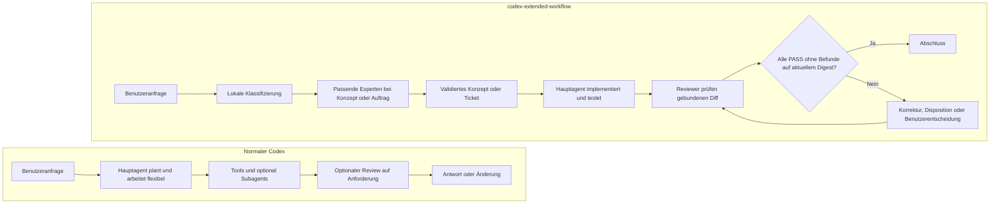

# 05 – Vergleich mit normalem Codex

## Wichtigste Einordnung

Beide Programme verwenden dieselbe grundlegende Codex-Laufzeit, dieselben
Werkzeuge, Sandboxmechanismen und Modellzugänge. Der Unterschied liegt nicht in
einem grundsätzlich „besseren“ Modell, sondern in der zusätzlichen
Orchestrierungs- und Validierungsschicht von `codex-extended-workflow`.

Normales Codex unterstützt ebenfalls Subagents. Sie können auf direkte
Anforderung, aufgrund von Repository-Anweisungen oder durch einen passenden
Skill eingesetzt werden. Die erweiterte CLI erzwingt darüber hinaus einen
konkreten Produktprozess mit Klassifizierung, Expertenrollen, strukturierten
Artefakten, Digest-Bindung und Reviewer-Abschluss-Gate.

## Vergleich als ASCII-Diagramm

```text
NORMALER CODEX                         CODEX-EXTENDED-WORKFLOW
────────────────────────────          ────────────────────────────────────

┌──────────────────────┐               ┌──────────────────────┐
│ Benutzeranfrage      │               │ Benutzeranfrage      │
└──────────┬───────────┘               └──────────┬───────────┘
           v                                      v
┌──────────────────────┐               ┌──────────────────────┐
│ Hauptagent plant und │               │ Anfrage lokal als    │
│ arbeitet flexibel    │               │ Antwort/Konzept/     │
└──────────┬───────────┘               │ Auftrag klassifizieren│
           │                           └──────────┬───────────┘
           ├── Tools                             v
           ├── Subagents optional     ┌──────────────────────┐
           └── Review auf Wunsch      │ Expertenprozess nach │
           │                           │ Klasse und Fachgebiet │
           v                           └──────────┬───────────┘
┌──────────────────────┐                          v
│ Antwort oder         │               ┌──────────────────────┐
│ implementierte       │               │ Konzept/Ticket samt │
│ Änderung             │               │ Akzeptanzkriterien   │
└──────────────────────┘               └──────────┬───────────┘
                                                  v
                                       ┌──────────────────────┐
                                       │ Nur Hauptagent setzt │
                                       │ um und testet        │
                                       └──────────┬───────────┘
                                                  v
                                       ┌──────────────────────┐
                                       │ Reviewer prüfen den  │
                                       │ gebundenen Diff      │
                                       └──────────┬───────────┘
                                                  v
                                       ┌──────────────────────┐
                                       │ Same-Digest-Gate:    │
                                       │ PASS ohne Befunde?   │
                                       └──────┬────────┬──────┘
                                            Ja        Nein
                                             v          v
                                       ┌──────────┐ ┌──────────┐
                                       │ Fertig   │ │ Korrektur│
                                       └──────────┘ │ oder Stopp│
                                                    └──────────┘
```

## Vergleich als Mermaid-Diagramm



## Funktionsvergleich

| Bereich | Normaler `codex`-Ablauf | `codex-extended-workflow` |
|---|---|---|
| Startbefehl | `codex` | `codex-extended-workflow` |
| Laufzeit | Codex | dieselbe Codex-Laufzeit plus Workflow-Schicht |
| Anfragebehandlung | flexibel durch Hauptagent | lokale Klasse `simple_answer`, `concept` oder `work_order` |
| Subagents | verfügbar, Einsatz abhängig von Prompt, Anweisungen und Skills | als Experten/Reviewer mit eigenem Prozessvertrag eingeplant |
| Expertenanzahl | kein spezielles Experten-Min/Max-Gate | unabhängig konfigurierbar, Standard `2..4`, maximal `6` |
| Revieweranzahl | kein spezielles Reviewer-Min/Max-Gate | unabhängig konfigurierbar, Standard `2..4`, maximal `6` |
| Rollen und Modelle | über normale Agentenkonfiguration bzw. Aufruf | je Experten-/Reviewerprofil sichtbar konfiguriert |
| Konzept/Ticket | bei Bedarf frei erstellt | strukturierter und validierter Pflichtschritt für passende Klassen |
| Schreibrechte | abhängig von Agent und Sandbox | Workflow-Experten und -Reviewer read-only; nur Hauptagent schreibt |
| Reviewstart | auf Anforderung oder durch Anweisung | automatisch nach Implementierung eines Arbeitsauftrags |
| Reviewgegenstand | vom jeweiligen Reviewauftrag abhängig | an konkreten binärsensitiven Working-Tree-Digest gebunden |
| Reviewer-PASS | Ergebnis des gewählten Reviews | formal gültig, `verdict=pass`, keine Befunde, aktuelle Digest-Bindung |
| Low/Medium | abhängig vom gewählten Prozess | müssen korrigiert oder akzeptiert disponiert und erneut geprüft werden |
| High/Critical | abhängig vom gewählten Prozess | releasekritisch und zwingend zu beheben |
| Korrekturversuche | nicht durch diesen Fork-Vertrag begrenzt | ein Format-Korrekturversuch und eine begrenzte Re-Review-Schleife |
| Tokensteuerung | normale Codex-Nutzung und Kontextgrenzen | zusätzlich hartes kumulatives Workflowlimit und Profil-Kontextlimits |
| Standard-State | `~/.codex` | isoliert unter `~/.codex-extended-workflow` |
| Resume-Ausgabe | `codex resume ...` | `codex-extended-workflow resume ...` |

## Vorteile von codex-extended-workflow

- **Wiederholbarkeit:** Ähnliche Arbeitsaufträge durchlaufen dieselben
  Qualitätsphasen.
- **Mehrere Fachperspektiven:** Architektur, Sicherheit, Tests,
  Kompatibilität, Performance oder Dokumentation lassen sich gezielt
  kombinieren.
- **Klare Umsetzungseinheit:** Tickets und Akzeptanzkriterien entstehen vor der
  eigentlichen Änderung.
- **Unabhängige Prüfung:** Reviewer beraten nicht nur, sondern prüfen den
  tatsächlichen Stand nach der Implementierung.
- **Schutz vor veraltetem PASS:** Ändert sich der Diff, kann der alte
  Digest-Nachweis den Workflow nicht abschließen.
- **Transparenz:** Name, Typ, Rolle, Modell, Reasoning-Stärke, Validierungsstatus
  und Befundschwere sind sichtbar.
- **Steuerbarer Verbrauch:** Anzahl der Agenten, Gesamtbudget und harte
  Kontextgrenzen sind konfigurierbar.
- **Datenisolation:** Sitzungen und State werden standardmäßig nicht mit dem
  normalen Codex-Verzeichnis vermischt.

## Nachteile und Kosten von codex-extended-workflow

- **Mehr Tokens und Laufzeit:** Zusätzliche Experten- und Revieweraufrufe
  kosten mehr als ein vergleichbarer Einzelagentenlauf.
- **Mehr formale Anforderungen:** Ein fachlich sinnvoller Bericht kann wegen
  Schema-, Evidenz- oder Aufgabenbindungsfehlern ungültig sein.
- **Bewusste Blockaden:** Befunde, ein geänderter Digest, ein ausgeschöpftes
  Budget oder fehlende valide Agentenantworten verhindern den Abschluss.
- **Konfigurationsaufwand:** Profile, Modelle, Grenzen und State-Modus müssen
  zur Organisation passen.
- **Keine Reparatur durch Reviewer:** Read-only-Reviewer können einen Fehler
  melden, aber nicht selbst beheben.
- **Für Kleinigkeiten überdimensioniert:** Eine einfache Wissensfrage profitiert
  meist nicht von einem vollständigen Mehragentenprozess.

## Vorteile des normalen Codex-Ablaufs

- schneller Einstieg und weniger Prozessaufwand,
- geringerer Tokenverbrauch für kleine und eindeutig begrenzte Aufgaben,
- hohe Flexibilität für explorative Arbeit,
- Subagents und Reviews können weiterhin gezielt angefordert werden,
- keine zusätzlichen Fork-spezifischen Datenverträge.

## Nachteile des normalen Codex-Ablaufs im direkten Vergleich

- Expertenauswahl und Reviewdisziplin hängen stärker vom Prompt, von
  `AGENTS.md`, Skills oder manuellen Entscheidungen ab,
- kein automatisch erzwungenes Ticket- und Akzeptanzkriterien-Gate,
- kein automatisch erzwungener Same-Digest-Mehrfachreview,
- kein spezielles, kumulatives Budget pro fachlichem Workflow.

## Entscheidungshilfe

| Situation | Sinnvolle Wahl |
|---|---|
| kurze Erklärung, Übersetzung oder kleine Recherche | normaler Codex-Ablauf |
| kleine, risikoarme Ein-Datei-Änderung | normaler Codex oder Extended mit deaktivierten Prozessen |
| Konzept mit mehreren Fachgebieten | `codex-extended-workflow` mit Experten |
| produktive Codeänderung mit Nachweispflicht | vollständiger Extended-Workflow |
| Security-, Berechtigungs- oder Migrationsänderung | vollständiger Extended-Workflow mit passenden Rollen |
| schnelle Exploration ohne Abschlussanspruch | normaler Codex-Ablauf |
| Releasekandidat mit festem Prüfdigest | Extended-Workflow mit Reviewer-Gate |

Der erweiterte Workflow ersetzt normales Codex nicht. Er ist eine strengere
Betriebsart für Aufgaben, bei denen nachvollziehbare Beratung und ein
verbindlicher Abschlussnachweis wichtiger sind als minimale Latenz.

Weiter mit [06 – Bedienung und Fehlerbehebung](06-bedienung-und-fehlerbehebung.md).
