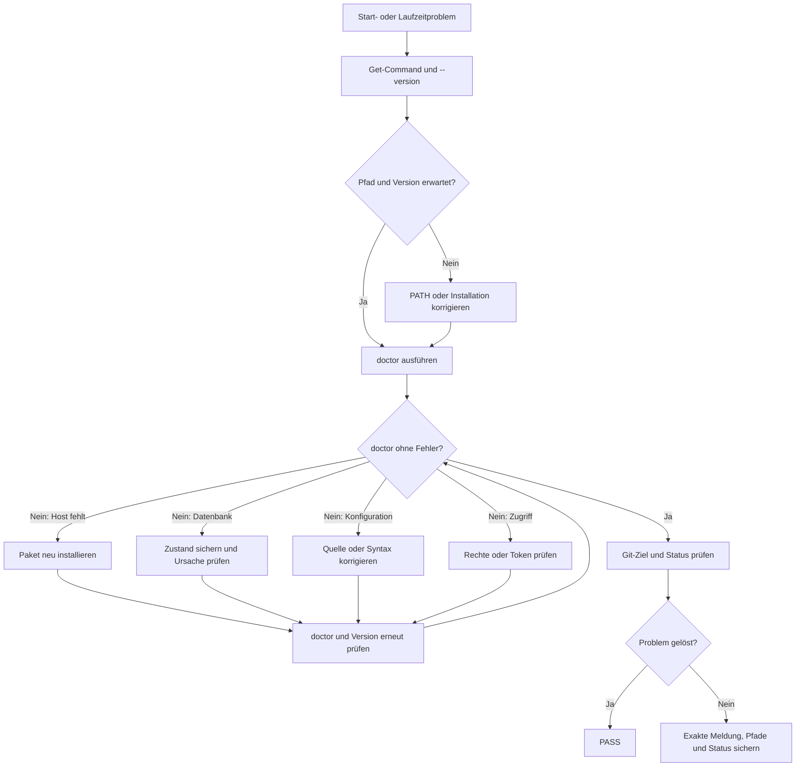

# 06 – Bedienung und Fehlerbehebung

## Befehlsübersicht

### Installation und Laufzeit prüfen

```powershell
Get-Command codex-extended-workflow
codex-extended-workflow --version
codex-extended-workflow --help
codex-extended-workflow doctor
```

### Repository vorbereiten

```powershell
# Vorschau im aktuellen Git-Worktree
codex-extended-workflow prepare-extend-workflow

# Vorschau anwenden
codex-extended-workflow prepare-extend-workflow --apply

# Explizites Repository aus beliebigem Arbeitsordner
codex-extended-workflow prepare-extend-workflow --cd D:\Pfad\zum\Repository
codex-extended-workflow prepare-extend-workflow --cd D:\Pfad\zum\Repository --apply

# Globale Extended-Workflow-Konfiguration
codex-extended-workflow prepare-extend-workflow --global
codex-extended-workflow prepare-extend-workflow --global --apply
```

### Sitzung starten oder fortsetzen

```powershell
$sessionId = "<SITZUNGS-ID>"
codex-extended-workflow
codex-extended-workflow resume $sessionId
codex-extended-workflow --shared-state
codex-extended-workflow --shared-state resume $sessionId
```

### Temporäre Prozesswerte

```powershell
codex-extended-workflow `
  --workflow-type work-order `
  --workflow-token-limit 50000 `
  --expert-min 2 `
  --expert-max 4 `
  --reviewer-min 2 `
  --reviewer-max 4
```

## Wichtige Slash-Befehle

| Befehl | Zweck |
| --- | --- |
| `/status` | aktuelle Sitzung, Modell, Version und Nutzung anzeigen |
| `/statusline` | Elemente wie Session- und Workflowtokens ein-/ausblenden |
| `/agent` | laufende oder abgeschlossene Agententhreads ansehen |
| `/workflow-type` | `auto`, `inactive`, `concept` oder `work-order` auswählen |
| `/workflow-type <TYPE>` | Workflow-Typ ohne Auswahldialog setzen |
| `/workflow-reset-budget` | aktiven Workflow aufgeben und sein Budget schließen |
| `/prepare-extend-workflow` | Repository-Vorbereitung in der TUI anzeigen |
| `/prepare-extend-workflow apply` | sichere Vorbereitung anwenden |

`close_agent` ist kein normaler Benutzerbefehl. Der Workflow verwendet das
Agentenwerkzeug intern, um abgeschlossene Child-Slots freizugeben. Ein aktiver
Workflow-Agent darf erst geschlossen werden, nachdem sein Ergebnis validiert
oder endgültig verworfen wurde.

## Diagnose in sinnvoller Reihenfolge

Bei einem Start- oder Laufzeitproblem werden zuerst diese nicht destruktiven
Prüfungen ausgeführt:

```powershell
Get-Command codex-extended-workflow | Format-List Source, Version
codex-extended-workflow --version
codex-extended-workflow doctor
git rev-parse --show-toplevel
git status --short
```

Danach erst die konkrete Fehlerklasse bearbeiten. Datenbanken, Sitzungen oder
Konfigurationsverzeichnisse niemals auf Verdacht löschen.

## Diagnoseworkflow

### ASCII

```text
[Start- oder Laufzeitproblem]
              |
              v
[Get-Command + --version]
              |
              v
    <Pfad und Version erwartet?>
          |                       |
        Nein                      Ja
          |                       |
[PATH/Installation korrigieren]   |
          |                       |
          +-----------+-----------+
                      |
                      v
             [doctor ausführen] <--------------------------+
                      |                                    |
                      v                                    |
            <doctor ohne Fehler?>                          |
               |               |                           |
              Ja              Nein                         |
               |               |                           |
     [Git-Ziel und Status]      v                           |
               |         <Fehlerklasse wählen>             |
               |           +-- Host: Paket neu installieren|
               |           +-- DB: sichern; Ursache prüfen |
               |           +-- Config: Quelle/Syntax       |
               |           +-- Zugriff: Rechte/Token       |
               |                       |                    |
               |                       v                    |
               |           [doctor + Version erneut prüfen]-+
               v
        <Problem gelöst?>
           |          |
          Ja         Nein
           |          |
        [PASS]   [exakte Meldung,
                  Pfade und Status sichern]
```

### Mermaid



Beide Diagramme verwenden dieselbe Reihenfolge. Destruktive Maßnahmen sind
kein Diagnoseschritt; insbesondere wird eine SQLite-Datei erst nach Sicherung
und eindeutiger Ursachenanalyse verändert.

## Fehler: nicht in einem Git-Worktree

Ausgabe:

```text
Repository preparation failed: not inside a Git worktree; run this command
from a repository or pass --cd <DIR>
```

Ursache: `prepare-extend-workflow` wurde außerhalb eines Git-Repositories
ausgeführt oder das falsche Ziel wurde gewählt.

Lösung:

```powershell
Set-Location D:\Pfad\zum\Repository
git rev-parse --show-toplevel
codex-extended-workflow prepare-extend-workflow
```

Alternativ:

```powershell
codex-extended-workflow prepare-extend-workflow --cd D:\Pfad\zum\Repository
```

## Fehler: Code Mode Host fehlt

Ausgabe ähnlich:

```text
Code Mode is unavailable because failed to spawn code-mode host ...
codex-code-mode-host.exe: host executable was not found.
```

Ursache: Meist wurde nur die CLI gebaut oder mit `cargo install` installiert,
ohne den separaten Host zu paketieren.

Lösung: Das vollständige Releasepaket mit dem projektspezifischen Installer dieses
Forks erneut installieren und danach prüfen:

```powershell
codex-extended-workflow --version
codex-extended-workflow doctor
```

Das im Quellrepository vorhandene Skript
`scripts/install/install-code-mode-host.ps1` ist ausschließlich an die alte
Alpha‑5-Einzelbinärinstallation gebunden. Es darf nicht als Reparatur- oder
Installationsweg für Alpha‑10 verwendet werden.

Das bloße Aktivieren eines Features erzeugt keine fehlende EXE.

## Fehler: lokale Datenbank kann nicht initialisiert werden

Ausgabe ähnlich:

```text
Codex couldn't start because its local database appears to be damaged.
```

Vorgehen:

1. Alle laufenden Instanzen der erweiterten CLI beenden.
2. `codex-extended-workflow doctor` ausführen und die technische Ursache lesen.
3. Vor jeder Reparatur das gesamte Verzeichnis
   `~/.codex-extended-workflow` sichern.
4. Prüfen, ob die installierte Version zur Version passt, mit der die Datenbank
   zuletzt geöffnet wurde.
5. Keine `state_*.sqlite`-Datei löschen, solange Sitzungen oder Nachweise noch
   benötigt werden.

Eine erneute Installation ersetzt die Binärdateien, repariert aber nicht
automatisch einen bereits inkonsistenten Datenbankstand.

## Warnung: projektlokale Schlüssel werden ignoriert

Ausgabe ähnlich:

```text
Ignored unsupported project-local config keys ...: notify, profiles
```

Das bedeutet: Die Datei wurde gefunden, aber bestimmte allgemeine
Benutzereinstellungen dürfen aus Sicherheits- oder Vertrauensgründen nicht aus
einem Repository übernommen werden. Es ist kein Fehler der verschachtelten
`extended_workflow.experts.profiles` oder
`extended_workflow.reviewers.profiles`.

Die genannten allgemeinen Schlüssel werden in die globale
Benutzerkonfiguration verschoben; in der Repository-Datei bleiben nur die dort
erlaubten Projektwerte. Die Warnung verhindert, dass ein Checkout unbemerkt
persönliche Benachrichtigungen oder globale Profile umkonfiguriert.

## Fehler: Rollen-Preflight blockiert die Runde

Typische Meldungen nennen `unknown agent_type`, einen Pfad außerhalb des
vertrauenswürdigen Konfigurationsbereichs, einen unzulässigen Rollenschlüssel
oder einen nach dem Preflight geänderten Fingerabdruck. In allen Fällen startet
die betroffene Experten- oder Reviewrunde nicht teilweise.

Die Konfiguration wird in dieser Reihenfolge geprüft:

1. Das optionale `agent_type` ist nicht leer und verweist auf die beabsichtigte
   Agentenrolle; der Profilname darf davon abweichen.
2. Die zugehörige `[agents.<name>]`-Definition ist in einer wirksamen
   Konfigurationsschicht vorhanden.
3. Der kanonisch aufgelöste Rollenpfad liegt unter dem deklarierenden
   vertrauenswürdigen Konfigurationsbereich.
4. Die Rollendatei enthält nur fachliche Anweisungen oder ausdrücklich
   zulässige Verschärfungen.
5. Nach einer beabsichtigten Rollenänderung wird ein neuer Workflowplan
   erzeugt; ein alter Kind-Agent wird nicht mit abweichender Rolle fortgesetzt.

Die vollständige Referenz steht in
[08 – Konfigurierbare Workflow-Rollen](08-konfigurierbare-workflow-rollen.md).

## Workflow-Typ auswählen und prüfen

Ohne Argument öffnet `/workflow-type` eine Liste mit genau vier Einträgen:

```text
Auto
Inaktiv
Konzept
Arbeitsauftrag
```

Alternativ lässt sich der technische Wert direkt angeben:

```text
/workflow-type auto
/workflow-type inactive
/workflow-type concept
/workflow-type work-order
```

`simple_answer` ist keine manuell erzwingbare Auswahl. Diese Anfrageklasse ist
weiterhin ein mögliches Ergebnis von `auto`. `inactive` schaltet nur die
automatische Extended-Workflow-Orchestrierung für neue Anfragen aus; die
normale Codex-Verarbeitung bleibt aktiv.

Die Auswahl gilt ab der nächsten Root-Anfrage und wird für Resume und Fork im
Thread gespeichert. Während eines aktiven Turns oder einer offenen
Workflow-Generation ist ein Wechsel gesperrt, damit weder Tokenbudget noch
Reviewer-Gate umgangen werden. `/new` beginnt wieder mit dem beim Start
geladenen Standard. Nach `resume` oder `fork` zeigt die TUI den gespeicherten
Workflow-Typ und die zuletzt effektive Anfrageklasse unmittelbar aus der
Lebenszyklusantwort an.

Statuszeile und `/status` unterscheiden Auswahl, effektive Anfrageklasse und
Budget:

```text
Workflow: auto · 304.285 / ∞ Tokens
Workflow: concept · 304.285 / 400.000 Tokens (76,1 %)
Workflow: work-order
Workflow: inaktiv
```

Bei `inactive` erscheint kein alter Workflowzähler. `/status` zeigt zusätzlich
die tatsächlich verwendete Anfrageklasse, etwa `work_order`; vor dem ersten
klassifizierten Turn steht dort `none`.

## Workflow-Ausgaben richtig lesen

Die Ausgabe zeigt vier voneinander unabhängige Ebenen. Deshalb können `PASS`,
`ELIGIBLE` und `BLOCKED` gleichzeitig korrekt sein.

| Ebene | Typische Werte | Bedeutung |
| --- | --- | --- |
| Agentenlaufzeit | `Running`, `Closed` | arbeitet der Child-Agent noch oder ist sein Slot frei? |
| Formale Validierung | `valid`, `invalid` | akzeptiert der Validator Struktur und Bindungen? |
| Ergebnis-Gate | `ELIGIBLE`, `NEEDS RESOLUTION`, `EXCLUDED`, Reviewer-`PASS` | darf oder muss dieser einzelne Beitrag weiterverarbeitet werden? |
| Gesamtquorum | `BLOCKED — 1/2 passing`, abgeschlossen | reichen alle Beiträge gemeinsam für den Abschluss? |

### Aufbau einer Agentenzeile

```text
expert_1: Expert | Architecture | gpt-5.6-sol | high | Running
```

| Feld | Bedeutung |
| --- | --- |
| `expert_1` | interner Name des Agentenprofils |
| `Expert` | beratender Read-only-Agent |
| `Architecture` | fachliche Rolle |
| `gpt-5.6-sol` | verwendetes Modell |
| `high` | konfigurierte Reasoning-Stufe, kein Konfidenz- oder Qualitätswert |
| `Running` | Agent arbeitet noch |

`xhigh` und `max` sind höhere konfigurierte Reasoning-Aufwände. Sie garantieren
weder Richtigkeit noch eine bestimmte Ergebnisqualität.

Bei aktivierter Farbausgabe verwendet eine Agentenzeile mehrere unabhängige
Farben: Profilname und Modell erscheinen cyan, der Agententyp magenta und
fett, die Fachrolle blau, die Reasoning-Stufe magenta sowie ein validierter
Status grün und fett. Ein ungültiger Bericht erscheint rot. Die
Schweregradanzeige verwendet Low gedimmt, Medium cyan sowie High und Critical
rot. Diese Farben sind nur Orientierung; die ausgeschriebenen Texte bleiben
verbindlich.

### Warten auf Agenten

```text
Waiting for agents
Finished waiting
└ No agents completed in this wait; running agents continue
```

In diesem Wartevorgang wurde kein neuer finaler Agentenabschluss geliefert.
Das Warten kann wegen des Wartefensters, Mailbox-Aktivität oder einer neuen
Benutzereingabe enden. Die Child-Agenten werden dadurch nicht beendet und der
Gesamtworkflow ist nicht automatisch fehlgeschlagen.

### Expertenergebnis

```text
expert_2 ... Needs resolution
Formal validation: valid
Gate: NEEDS RESOLUTION
Findings: 4 | max severity: not applicable
```

- `valid` bedeutet: Der Validator akzeptiert Schema, Pflichtfelder, Evidenz,
  Größenlimit, Agentenidentität sowie Turn- und Auftragsbindung. Bei Reviewern
  gehört auch die Digest-Bindung dazu. Es ist keine Garantie für die
  fachliche Wahrheit jeder Aussage.
- `Findings: 4` zählt nur Einträge im Feld `findings`; Empfehlungen und
  Unsicherheiten besitzen eigene Felder.
- Experten-Findings sind Feststellungen und nicht automatisch Programmfehler.
- `NEEDS RESOLUTION` fordert den Hauptagenten auf, diese Feststellungen
  auszuwerten. Es ist nicht dasselbe wie ein blockierender Reviewerbefund.
- Experten besitzen keine Reviewer-Severity. Deshalb ist `not applicable`
  erwartbar und bedeutet nicht „unbekannt gefährlich“.

### Reviewer-PASS und Gesamtquorum

```text
reviewer_2 ... PASS
Gate: ELIGIBLE
Review round: BLOCKED — 1/2 passing
```

Der einzelne Reviewer hat bestanden und sein gültiger Bericht darf gezählt
werden. Für den Gesamtabschluss sind jedoch zwei gültige PASS-Ergebnisse
erforderlich, sodass die Runde zu diesem Zeitpunkt erst bei `1/2` steht. Die
Zeile allein sagt nicht, ob der andere Reviewer noch arbeitet, ungültig
antwortete oder einen aufzulösenden Befund meldete.

Das endgültige Gate verlangt unterschiedliche vorgesehene Rollen und bindet
alle gezählten Reviewer an denselben aktuellen Diff-Digest.

### Diff-Digest

```text
Diff digest: 861872865219
```

Die TUI zeigt die ersten zwölf Zeichen eines vollständigen SHA‑256-Digests des
binärsensitiven Git-Diffs der verfolgten und nicht verfolgten Änderungen gegen
`HEAD`. Das ist keine Commit-ID. Ändert sich der Diff, müssen die betroffenen
Reviews auf dem neuen Stand wiederholt werden.

### Agent geschlossen

```text
Closed reviewer_2 [Reviewer]
```

Der Agentenprozess ist beendet und sein Parallelitätsslot wieder frei. Ein
bereits validiertes Ergebnis bleibt erhalten und kann weiterhin in das Gate
einfließen. Deshalb können `Needs resolution` und danach `Closed expert_1`
gemeinsam korrekt sein.

### Konzept oder Ticket validiert

```text
workflow_class_control_ticket_v1 ... Validated
Gate: ELIGIBLE
```

Das Artefakt erfüllt den strukturellen Vertrag und darf im nächsten Schritt
verwendet werden. Es ist damit nicht automatisch vom Benutzer genehmigt,
implementiert, getestet oder ein Beleg für den Abschluss des Gesamtworkflows.

### Kurzglossar

| Status | Bedeutet | Bedeutet nicht |
| --- | --- | --- |
| `valid` | Validator akzeptiert Vertrag, Evidenz und Bindungen | jede Aussage ist garantiert richtig |
| `eligible` | Beitrag darf für den nächsten Schritt verwendet werden | Gesamtworkflow ist abgeschlossen |
| Reviewer-`PASS` | gültiger Bericht, leere Befundliste und korrekte Digest-Bindung | das vollständige Reviewerquorum ist erreicht |
| `needs resolution` | Feststellungen müssen ausgewertet werden | zwingend ein releasekritischer Fehler |
| `blocked 1/2` | Quorum ist aktuell unvollständig | automatisch ein endgültiger Fehler |
| `closed` | Agent beendet und Slot frei | validiertes Ergebnis wurde gelöscht |

## Meldung: Bericht ungültig, Rejected oder Excluded

Diese Statuswerte bedeuten nicht automatisch, dass der Agent die Änderung
fachlich abgelehnt hat. Der separate Validator konnte den Beitrag nicht als
gültigen Workflow-Nachweis akzeptieren.

Typische Reason Codes:

| Code | Bedeutung | Sinnvolle Reaktion |
| --- | --- | --- |
| `task_binding_mismatch` | Subject oder Inhalt passt nicht zur gebundenen Aufgabe | konkrete Root-Aufgabe und Änderungsgegenstand verwenden |
| `schema_consistency` | Verdict, Befunde oder Schweregrad widersprechen einander | strukturierten Bericht konsistent korrigieren |
| `invalid_report_format` | erwartetes JSON/Schema nicht erfüllt | nur den geforderten Vertrag liefern |
| `missing_evidence` | Behauptung ohne benötigten Nachweis | Dateistellen, Tests oder konkrete Beobachtung ergänzen |
| `size_limit_exceeded` | Ergebnis überschreitet `max_result_bytes` | präziser und kürzer berichten |
| `terminal_output_mismatch` | validiertes Ergebnis ist nicht die endgültige Agentenausgabe | korrigiertes JSON als letzte Ausgabe liefern |
| `change_digest_mismatch` | Bericht gehört zu einem anderen Working-Tree-Stand | neuen Digest planen und Review erneut ausführen |
| `contract_violation` | Agentenidentität, Aufgabenart oder Ergebnisvertrag wurde verletzt | gebundenen Auftrag und erwarteten Vertrag unverändert verwenden |
| `correction_exhausted` | einziger Korrekturversuch wurde verbraucht | Workflow stoppt; Benutzerentscheidung nötig |
| `technical_failure` | Nachweis konnte technisch nicht sicher geprüft werden | Laufzeitproblem zuerst beheben |

Kurze Folgeprompts wie nur `1`, `ja` oder `weiter` können für Menschen eindeutig
wirken, sind aber ohne gebundenen Kontext als Reviewgegenstand ungeeignet. Eine
umzusetzende Auswahl wird deshalb möglichst vollständig formuliert:

```text
Bitte Option 1 umsetzen: Ändere den Git-Abschnitt auf einen vollständigen
git diff --cached und teste ihn mit einer bereits vorgemerkten Fremddatei.
```

## Workflow stoppt wegen geändertem Digest

Wenn der Working-Tree-Diff nach der Reviewer-Planung verändert wurde, passt der
aktuelle Digest nicht mehr zum geprüften Stand. Das ist eine beabsichtigte
Sicherheitsfunktion.

Erforderlich ist:

1. Änderung und Tests fertigstellen,
2. neuen Reviewerplan auf dem aktuellen Diff erstellen,
3. alle erforderlichen Rollen auf diesem neuen Digest prüfen lassen,
4. Working Tree bis zum Abschluss-Gate unverändert lassen.

Ein alter PASS wird nicht auf den neuen Stand übertragen.

## Workflow-Tokenlimit erreicht

In der interaktiven TUI erscheint eine Auswahl:

```text
+100% des Basislimits
+75% des Basislimits
+50% des Basislimits
+25% des Basislimits
Stop
```

Eine Freigabe erhöht die Obergrenze; sie setzt den bisherigen Verbrauch nicht
zurück. Bei `exec` gibt es keine interaktive Nachfrage. Ohne hartes Limit wird
beim nächsten Start `--workflow-token-limit 0` verwendet oder
`workflow_budget_tokens = 0` gesetzt.

`/workflow-reset-budget` ist kein kostenloses Fortsetzen desselben Workflows:
Der aktive Workflow wird dabei aufgegeben. Der nächste Workflow erhält ein
neues Budget, während die Session-Gesamttokens erhalten bleiben.

## Falsche oder alte Version wird gestartet

Prüfen:

```powershell
Get-Command codex-extended-workflow -All
codex-extended-workflow --version
```

Mehrere Treffer bedeuten, dass die `PATH`-Reihenfolge entscheidet. Ein lokales
`target\release\codex-extended-workflow.exe` wird durch einen Debug-Build nicht
automatisch aktualisiert. Für Endanwender ist die verwaltete Releaseinstallation
eindeutiger.

Der Befehl `codex` darf weiterhin auf die offizielle Codex-CLI zeigen. Für
diesen Fork ist ausschließlich `codex-extended-workflow` der eindeutige
Launcher.

## `--shared-state` bewusst verwenden

Standardmäßig sind State und Sitzungen getrennt. Mit `--shared-state` verwendet
die erweiterte CLI den normalen Codex-State und dessen Sitzungen, während die
Anmeldedaten der erweiterten Produktidentität isoliert bleiben.

Der Schalter wird nur verwendet, wenn die gemeinsame Sitzungshistorie
ausdrücklich gewünscht ist. `--shared-state` darf nicht mit einem eigenen
`CODEX_HOME` kombiniert werden; diese mehrdeutige Kombination wird abgewiesen.

## Wenn die Ursache danach noch unklar ist

Für eine weitere Diagnose werden ohne Veröffentlichung von Geheimnissen
folgende Angaben gesammelt:

- vollständige `--version`-Ausgabe,
- Pfad aus `Get-Command`,
- Ausgabe von `doctor`,
- konkreten Startbefehl,
- relevante Fehlermeldung,
- ob normaler oder `--shared-state`-Modus verwendet wurde,
- Repository-Root und `git status --short`,
- bei Reviewproblemen den angezeigten Reason Code und die ersten Zeichen des
  Digest, aber keine Zugangsdaten.

Zurück zur [Übersicht](README.md).
