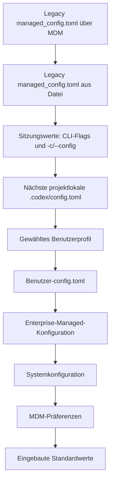

# 07 – `.codex/config.toml` verstehen und sicher verwenden

Diese Anleitung beschreibt den für
`codex-extended-workflow v0.147.1-alpha-10` vorgesehenen Quellkandidaten. Sie
erklärt die projektlokale Datei `.codex/config.toml`, ihre Abgrenzung zur
Benutzerkonfiguration und die wichtigsten Extended-Workflow-Werte.

> **Versionshinweis:** Alpha‑9 enthält `workflow_type`, `--workflow-type`,
> `/workflow-type`, `additional_profiles` und `selection_keywords` nicht. Die
> Werte sind nur in einer Alpha‑10-Installation verfügbar, deren Tag den
> Release-Workflow erfolgreich durchlaufen hat.

## Kurz erklärt

`config.toml` ist eine Konfigurationsdatei im TOML-Format. Sie bestimmt zum
Beispiel:

- welches Modell und welche Reasoning-Stufe der Hauptagent verwendet;
- ob der Extended Workflow aktiv ist;
- ob Anfragen automatisch, als Konzept, als Arbeitsauftrag oder ohne Extended
  Workflow verarbeitet werden;
- wie viele Experten und Reviewer eingesetzt werden dürfen;
- welche Rollen, Modelle und Reasoning-Stufen diese Subagents besitzen;
- welches Workflow-Tokenlimit gilt;
- welche Werte in der TUI-Statuszeile sichtbar sind.

Die Datei enthält Einstellungen, aber keine Arbeitsanweisungen. Regeln für den
Agenten gehören in `AGENTS.md`; API-Schlüssel und andere Geheimnisse gehören
weder in `config.toml` noch ins Git-Repository.

Nur ausdrücklich gesetzte Werte überschreiben die darunterliegende
Konfiguration. Alle anderen Werte stammen aus einer niedrigeren
Konfigurationsebene oder aus den eingebauten Standardwerten.

## Welche Datei ist wofür zuständig?

| Datei | Zweck | In Git einchecken? |
| --- | --- | --- |
| `<Repository>\.codex\config.toml` | reproduzierbare Einstellungen für genau dieses vertrauenswürdige Repository | ja, wenn sie keine Geheimnisse oder persönlichen Maschinenpfade enthält |
| `%USERPROFILE%\.codex-extended-workflow\config.toml` | persönliche Standardwerte der standardmäßig isolierten Extended-Workflow-CLI | nein |
| `%USERPROFILE%\.codex\config.toml` | persönliche Standardwerte des normalen `codex`; wird auch bei `codex-extended-workflow --shared-state` als State- und Konfigurationsbasis verwendet | nein |
| `AGENTS.md` | Repository-Anweisungen für die Arbeit des Agenten | je nach Repository |
| `.codex\agents\*.toml` | optionale fachliche Anweisungen für über `agent_type` referenzierte Workflow-Rollen | nur wenn diese Rollen bewusst zum Repository gehören |

Der Standardaufruf `codex-extended-workflow` hält State und
Benutzerkonfiguration unter `.codex-extended-workflow` vom normalen Codex
getrennt. `--shared-state` verwendet dagegen den normalen `.codex`-State und
dessen Benutzerkonfiguration; die Extended-Workflow-Anmeldedaten bleiben
trotzdem isoliert.

Ein ausdrücklich gesetztes `CODEX_HOME` verändert den Benutzerpfad. Der Wert
soll nur bewusst gesetzt werden; der tatsächlich verwendete Pfad lässt sich mit
`codex-extended-workflow doctor` prüfen.

## Konfigurationsvorrang

Die Implementierung führt die normalen Konfigurationsebenen von hoher zu
niedriger Priorität in dieser Reihenfolge zusammen:



Dasselbe als ASCII-Diagramm:

```text
höchste Priorität
       |
       v
[Legacy managed_config.toml über MDM]
       |
       v
[Legacy managed_config.toml aus Datei]
       |
       v
[Sitzungswerte: CLI-Flags und -c/--config]
       |
       v
[nächste projektlokale .codex/config.toml]
       |
       v
[gewähltes Benutzerprofil]
       |
       v
[Benutzer-config.toml]
       |
       v
[Enterprise-Managed-Konfiguration]
       |
       v
[Systemkonfiguration]
       |
       v
[MDM-Präferenzen]
       |
       v
[eingebaute Standardwerte]
       |
       v
niedrigste Priorität
```

Die beiden `Legacy managed_config.toml`-Ebenen sind ausdrücklich als
Kompatibilitätsquellen implementiert und besitzen deshalb die höchste
Merge-Priorität. Codex lädt projektlokale `.codex`-Ebenen nur, wenn das Projekt als
vertrauenswürdig gilt. Existieren mehrere `.codex/config.toml` zwischen
Repositorywurzel und aktuellem Arbeitsverzeichnis, gewinnt bei demselben
Schlüssel die Datei, die dem aktuellen Verzeichnis am nächsten liegt.

Administrativ erzwungene Anforderungen sind von dieser Merge-Reihenfolge
getrennt. Sie können den wirksamen Wert anschließend begrenzen und dürfen nicht
von einer normalen Konfigurationsebene gelockert werden.

Für `workflow_type` kommen laufende Thread-Einstellungen hinzu. Die wirksame
Reihenfolge lautet: `enabled = false`, aktuelle Slash-Auswahl, explizites
`--workflow-type`, beim Resume gespeicherte Auswahl, danach geladener
Konfigurationsstandard. Ein Fork übernimmt den Wert; `/new` beginnt wieder mit
dem geladenen Startstandard.

## Empfohlener Einrichtungsweg

### 1. In den Git-Worktree wechseln

```powershell
Set-Location D:\Pfad\zum\Repository
git rev-parse --show-toplevel
```

Erwartetes Ergebnis: Git gibt die absolute Repositorywurzel aus. Andernfalls
nicht mit der Vorbereitung fortfahren.

### 2. Änderung nur als Vorschau anzeigen

```powershell
codex-extended-workflow prepare-extend-workflow
```

Ohne `--apply` verändert der Befehl keine Datei.

### 3. Vorschau anwenden

```powershell
codex-extended-workflow prepare-extend-workflow --apply
```

Der Befehl erstellt eine fehlende `.codex/config.toml`. Eine vorhandene Datei
wird nicht überschrieben:

| Ausgangslage | Ergebnis |
| --- | --- |
| Datei fehlt | vollständige Standardvorlage wird erstellt |
| gültiger `[extended_workflow]`-Abschnitt vorhanden | vorhandene Datei bleibt unverändert |
| Datei vorhanden, Abschnitt fehlt | sicherer Konflikt; Abschnitt manuell ergänzen |
| `extended_workflow.enabled = false` | bewusste Deaktivierung bleibt erhalten |
| ungültiges TOML | Fehler; zuerst Syntax korrigieren |

### 4. Datei prüfen und anpassen

```powershell
Get-Content .\.codex\config.toml
git diff -- .codex/config.toml
```

Vor einem Commit werden insbesondere Modelle, Rollen, Min-/Max-Werte und das
Tokenlimit geprüft. Benötigte Teamvorgaben bleiben erhalten, auch wenn sie von
persönlichen Standardwerten abweichen.

### 5. Konfiguration validieren

```powershell
codex-extended-workflow prepare-extend-workflow
codex-extended-workflow doctor
```

Die erneute Prepare-Vorschau parst die Projektdatei und validiert den
`extended_workflow`-Abschnitt. `doctor` prüft zusätzlich Installation,
Benutzerpfad und die dortige Benutzerkonfiguration.

Danach wird die TUI gestartet:

```powershell
codex-extended-workflow
```

In der TUI:

```text
/status
/statusline
```

Erwartetes Ergebnis: keine Config-Fehlermeldung; Modell, Reasoning-Stufe und
Workflow-Tokenanzeige entsprechen den beabsichtigten Werten.

## TOML-Grundregeln

```toml
# Kommentar
model = "gpt-5.6-sol"          # Textwert in Anführungszeichen

[extended_workflow]             # einzelne Tabelle
workflow_type = "auto"          # Textwert mit einem der erlaubten Werte
workflow_budget_tokens = 16000  # Ganzzahl ohne Anführungszeichen
enabled = true                  # Boolean ohne Anführungszeichen

[[extended_workflow.experts.profiles]] # Element einer Tabellenliste
name = "expert_1"
role = "Architecture"
```

Wichtig:

- Root-Schlüssel wie `model` und `model_reasoning_effort` stehen vor der ersten
  Tabelle. Nach `[extended_workflow]` gehören folgende einfache Schlüssel zu
  dieser Tabelle.
- Jeder `[[extended_workflow.experts.profiles]]`-Block erzeugt ein neues
  Expertenprofil. Für Reviewer gilt dasselbe.
- Schlüssel dürfen innerhalb derselben Tabelle nicht doppelt vorkommen.
- Zahlen und Booleans werden nicht in Anführungszeichen gesetzt.
- Kommentare beginnen mit `#`.
- Ein Tippfehler erzeugt nicht automatisch eine ähnliche Einstellung. Bei
  strenger Validierung wird ein unbekannter Schlüssel abgewiesen.

## Kompakte, gültige Projektkonfiguration

Das folgende Beispiel verwendet bewusst genau zwei Experten und zwei
Reviewer. Für den Standardbereich von zwei bis vier bleibt die vollständige,
von `prepare-extend-workflow` erzeugte Vorlage erhalten; alternativ werden
mindestens vier unterschiedliche Profile je aktiviertem Prozess definiert.

```toml
# Hauptagent: Root-Schlüssel müssen vor den Tabellen stehen.
model = "gpt-5.6-sol"
model_reasoning_effort = "high"

[extended_workflow]
enabled = true
workflow_type = "auto"
audit_mode = true
# 0 = unbegrenzt; positiver Wert = hartes Gesamtlimit je Workflow.
workflow_budget_tokens = 0
max_result_bytes = 8192

[extended_workflow.experts]
enabled = true
min = 2
max = 2

[[extended_workflow.experts.profiles]]
name = "expert_architecture"
role = "Architecture"
selection_keywords = ["architecture", "architektur", "design"]
model = "gpt-5.6-sol"
reasoning_effort = "high"

[[extended_workflow.experts.profiles]]
name = "expert_security"
role = "Security and permissions"
selection_keywords = ["security", "sicherheit", "permission"]
model = "gpt-5.6-terra"
reasoning_effort = "xhigh"

[extended_workflow.reviewers]
enabled = true
min = 2
max = 2

[[extended_workflow.reviewers.profiles]]
name = "reviewer_correctness"
role = "Correctness and architecture"
selection_keywords = ["correctness", "korrektheit", "architecture"]
model = "gpt-5.6-sol"
reasoning_effort = "high"

[[extended_workflow.reviewers.profiles]]
name = "reviewer_testing"
role = "Testing and regression"
selection_keywords = ["test", "testing", "regression"]
model = "gpt-5.5"
reasoning_effort = "high"

[tui]
status_line = ["model-with-reasoning", "session-tokens", "workflow-tokens"]
status_line_use_colors = true
```

Die Modellprofile entsprechen weiterhin den Standardprofilen dieses Forks.
Das jeweilige Modell muss im aktiven Konto beziehungsweise Modellkatalog
verfügbar sein und die gewählte Reasoning-Stufe unterstützen.

## Schlüssel verständlich erklärt

### Hauptagent

| Schlüssel | Bedeutung |
| --- | --- |
| `model` | Modell des Hauptagenten |
| `model_reasoning_effort` | Reasoning-Stufe des Hauptagenten |

Diese Werte gelten nicht automatisch für Experten und Reviewer. Deren Modelle
stehen in den jeweiligen Profilblöcken.

### `[extended_workflow]`

| Schlüssel | Bedeutung |
| --- | --- |
| `enabled` | aktiviert Klassifizierung und Extended-Workflow-Orchestrierung |
| `workflow_type` | Startauswahl `auto`, `inactive`, `concept` oder `work-order` |
| `audit_mode` | aktiviert normale modell-sichtbare Workflowdiagnosen; schreibt keine Receipt-Dateien |
| `workflow_budget_tokens` | hartes gemeinsames Provider-Tokenlimit für Hauptagent, Experten, Reviewer und Kompaktierungen; `0` ist unbegrenzt |
| `max_result_bytes` | maximale UTF‑8-Größe eines strukturierten Experten-, Reviewer-, Konzept- oder Ticketergebnisses; gültig sind `1..9000` |

Ein entsprechendes `workflow_credits_limit` existiert nicht. Credits sind eine
separate konto- und produktspezifische Abrechnungsgröße und werden nicht je
Workflow einheitlich zugerechnet. Das harte Workflow-Gate verwendet deshalb
ausschließlich die vom Provider gemeldeten Tokens.

### Experten- und Reviewerprozess

| Schlüssel | Bedeutung |
| --- | --- |
| `enabled` | schaltet nur diesen Prozess ein oder aus |
| `min` | kleinste erlaubte Zahl ausgewählter Profile |
| `max` | größte erlaubte Zahl ausgewählter Profile |
| `round_budget_tokens` | optionaler beratender Planungswert für eine komplette Runde, kein harter Verbrauchsstopp |
| `profiles` | ersetzt den eingebauten Profilkatalog dieses Prozesses |
| `additional_profiles` | ergänzt den nach der Schichtauflösung wirksamen Katalog |

Für beide Prozesse gilt:

```text
0 <= min <= max <= 6
```

Bei einem aktivierten Prozess muss die effektive, explizit konfigurierte oder
eingebaute Profilliste mindestens so viele unterschiedliche Profile enthalten
wie der Wert von `max`. Profilnamen und Rollen müssen innerhalb ihres
Prozesses eindeutig sein.

Der Katalog darf bis zu 16 Profile enthalten. `max` bleibt auf 6 gleichzeitig
ausgewählte Profile begrenzt.

Die Laufzeit leitet die benötigte Parallelitätsgrenze aus dem größeren
aktivierten `max`-Wert ab. Für die Standardkonfiguration ist deshalb kein
zusätzlicher manueller Thread-Limit-Schlüssel erforderlich.

### Ein Profil

| Schlüssel | Bedeutung |
| --- | --- |
| `name` | eindeutiger technischer und sichtbarer Profilname |
| `role` | fachliche Zuständigkeit für Auswahl und Aufgabenbindung |
| `model` | Modell dieses Subagents |
| `reasoning_effort` | Reasoning-Stufe dieses Subagents |
| `agent_type` | optionaler Verweis auf eine bestehende `[agents.<name>]`-Rolle |
| `selection_keywords` | höchstens zwölf lokale Auswahlbegriffe oder Wortfolgen; keine Rollenanweisung, Treffer können aber in der begrenzten Plandiagnose erscheinen |
| `token_budget` | optionaler beratender Planungswert, kein exakter Stopp |
| `context_budget` | harte lokale Obergrenze für den vollständigen gebundenen Subagent-Kontext |

Die unterschiedliche Schreibweise ist beabsichtigt:

```text
Hauptagent: model_reasoning_effort
Subagent:   reasoning_effort
```

### `[tui]`

| Schlüssel | Bedeutung |
| --- | --- |
| `status_line` | geordnete Liste der sichtbaren Statuszeilenelemente |
| `status_line_use_colors` | aktiviert die zusätzliche farbliche Darstellung |

Die Anzeige lässt sich später interaktiv über `/statusline` anpassen.

## Häufige Anpassungen

Die folgenden Ausschnitte ändern jeweils den bereits vorhandenen Abschnitt.
Dieselbe Tabellenüberschrift darf in einer TOML-Datei nicht ein zweites Mal
angelegt werden.

### Workflow-Typ festlegen

```toml
[extended_workflow]
workflow_type = "concept"
```

Gültig sind:

| Wert | Wirkung |
| --- | --- |
| `auto` | vorhandene Klassifizierung entscheidet zwischen einfacher Antwort, Konzept und Arbeitsauftrag |
| `inactive` | normale Codex-Verarbeitung ohne automatische Extended-Workflow-Gates |
| `concept` | Anfrageklasse `concept` erzwingen |
| `work-order` | Anfrageklasse `work_order` erzwingen |

Die Auswahl lässt sich in der TUI mit `/workflow-type` ändern. Sie gilt ab der
nächsten Root-Anfrage, wird im Thread gespeichert und schreibt die TOML-Datei
nicht um. Ein Wechsel ist während eines aktiven Turns oder einer offenen
Workflow-Generation absichtlich gesperrt.

### Workflow auf 50.000 Tokens begrenzen

```toml
[extended_workflow]
workflow_budget_tokens = 50000
```

Die Zahl gilt gemeinsam für den vollständigen aktiven Workflow. Bereits
verbrauchte Tokens werden beim Erhöhen des Limits nicht zurückgesetzt.

### Immer genau vier Reviewer verwenden

```toml
[extended_workflow.reviewers]
enabled = true
min = 4
max = 4
```

Dafür müssen mindestens vier unterschiedliche Reviewerprofile vorhanden sein.

### Fachprofil ergänzen, ohne Standardprofile zu ersetzen

```toml
[agents.database_migration]
description = "Prüft Datenbankmigrationen und Datenintegrität."
config_file = "./agents/database-migration.toml"

[[extended_workflow.experts.additional_profiles]]
name = "database_migration"
role = "Database migration and data integrity"
agent_type = "database_migration"
selection_keywords = ["database", "datenbank", "schema migration", "rollback"]
model = "gpt-5.6-sol"
reasoning_effort = "high"
context_budget = 24000
```

Die fachlichen `developer_instructions` liegen getrennt unter
`.codex/agents/database-migration.toml`. Zulässige Schlüssel und
Sicherheitsgrenzen stehen in
[08 – Konfigurierbare Workflow-Rollen](08-konfigurierbare-workflow-rollen.md).

### Expertenprozess deaktivieren

```toml
[extended_workflow.experts]
enabled = false
min = 0
max = 0
```

### Reviewerprozess deaktivieren

```toml
[extended_workflow.reviewers]
enabled = false
min = 0
max = 0
```

Damit entfällt bewusst das automatische Reviewer-Abschluss-Gate.

### Nur für einen Start überschreiben

```powershell
codex-extended-workflow `
  --workflow-type work-order `
  --workflow-token-limit 50000 `
  --expert-min 2 `
  --expert-max 3 `
  --reviewer-min 3 `
  --reviewer-max 4
```

Diese CLI-Werte ändern die Datei nicht.

## Was gehört nicht in die Projektdatei?

Projektkonfiguration kommt aus dem ausgecheckten Repository. Deshalb darf sie
weder den Zielort persönlicher Anmeldedaten noch lokale Benachrichtigungs- oder
Telemetrieprozesse umleiten.

Diese Schlüssel werden projektlokal ignoriert und gehören, falls wirklich
benötigt, in die Benutzerkonfiguration:

```text
openai_base_url
chatgpt_base_url
apps_mcp_product_sku
model_provider
model_providers
notify
profile
profiles
experimental_realtime_webrtc_call_base_url
experimental_realtime_ws_base_url
otel
features.respect_system_proxy
```

Besonders wichtig ist die Unterscheidung:

```text
[profiles.mein_profil]                         -> projektlokal ignoriert
[[extended_workflow.experts.profiles]]         -> projektlokal erlaubt
[[extended_workflow.reviewers.profiles]]       -> projektlokal erlaubt
```

Die Warnung

```text
Ignored unsupported project-local config keys ...: notify, profiles
```

bedeutet daher nicht, dass die Extended-Workflow-Profillisten fehlerhaft sind.
Sie bezieht sich auf die root-level Schlüssel `notify` und `profiles`.

API-Schlüssel, Zugriffstokens, Passwörter und private Zertifikate werden in
keiner der genannten Dateien gespeichert. Dafür gelten die vorgesehenen Login-,
Keyring- oder Umgebungsvariablenmechanismen.

## Häufige Fehler

| Problem | Ursache | Korrektur |
| --- | --- | --- |
| Alpha‑10-Schlüssel wird nicht erkannt | installierte CLI ist noch Alpha‑9 oder älter | nach Veröffentlichung Alpha‑10 installieren und `--version` prüfen |
| `unknown agent_type` | Profil verweist auf keine wirksame Agentenrolle | `[agents.<name>]` und Schreibweise prüfen |
| Rollendatei liegt außerhalb des Vertrauensbereichs | kanonischer Pfad verlässt die deklarierende Konfiguration | Datei unter einem vertrauenswürdigen `.codex`-Bereich ablegen |
| Workflow-Typ wird abgewiesen | Wert ist nicht exakt `auto`, `inactive`, `concept` oder `work-order` | einen der vier technischen Werte verwenden |
| `/workflow-type` lässt sich nicht wechseln | Turn oder Workflow-Generation ist noch aktiv | laufenden Workflow regulär abschließen oder ausdrücklich zurücksetzen |
| Projektwerte wirken nicht | Repository ist nicht vertrauenswürdig oder falscher Arbeitsordner | Projektvertrauen und `git rev-parse --show-toplevel` prüfen |
| `notify, profiles` werden ignoriert | root-level Benutzerschlüssel stehen in der Projektdatei | in die aktive Benutzerkonfiguration verschieben |
| `min` ist größer als `max` | ungültiger Bereich | `0 <= min <= max <= 6` herstellen |
| `max = 4`, aber nur zwei Profile | nicht genug unterschiedliche Rollen | zwei weitere Profile ergänzen oder `max` auf `2` reduzieren |
| Hauptagent nutzt falsche Reasoning-Stufe | `reasoning_effort` am Root verwendet | Root-Schlüssel `model_reasoning_effort` verwenden |
| Subagent nutzt falsche Reasoning-Stufe | `model_reasoning_effort` im Profil verwendet | Profilfeld `reasoning_effort` verwenden |
| Root-Schlüssel wird nicht erkannt | Schlüssel steht nach einer Tabellenüberschrift und gehört dadurch zur falschen Tabelle | Root-Schlüssel an den Dateianfang verschieben |
| Prepare meldet Konflikt | vorhandene Datei wird absichtlich nicht überschrieben | Abschnitt manuell zusammenführen und erneut als Vorschau prüfen |
| Modell oder Effort wird abgewiesen | Kombination ist im aktiven Modellkatalog nicht verfügbar | verfügbares Modell und unterstützte Reasoning-Stufe wählen |

## Abschlusscheck

Vor dem ersten echten Arbeitsauftrag sollten alle Punkte erfüllt sein:

- [ ] Datei liegt unter `<Repository>\.codex\config.toml`.
- [ ] Repository ist vertrauenswürdig.
- [ ] Root-Schlüssel stehen vor den Tabellen.
- [ ] Keine Geheimnisse oder persönlichen Benachrichtigungsbefehle enthalten.
- [ ] Für jedes aktivierte `max` existieren genügend eindeutige Profile.
- [ ] Experten- und Reviewerrollen passen zum Repository.
- [ ] `workflow_type` ist bewusst gewählt; Standard ist `auto`.
- [ ] Tokenlimit ist bewusst gewählt; `0` bedeutet unbegrenzt.
- [ ] Prepare-Vorschau akzeptiert die vorhandene Konfiguration.
- [ ] `doctor` meldet keinen Config- oder Installationsfehler.
- [ ] `/status` und `/statusline` zeigen die erwarteten Werte.
- [ ] `git diff -- .codex/config.toml` enthält nur beabsichtigte Änderungen.

## Weiterführende Dokumentation

- [Vollständige Extended-Workflow-Konfigurationsreferenz](04-konfiguration.md)
- [Repository vorbereiten](02-schnellstart-und-vorbereitung.md)
- [Bedienung und Fehlerbehebung](06-bedienung-und-fehlerbehebung.md)
- [Konfigurierbare Workflow-Rollen](08-konfigurierbare-workflow-rollen.md)
- [Offizielle OpenAI Docs: Grundlagen der Codex-Konfiguration](https://learn.chatgpt.com/de-DE/docs/config-file/config-basic)
