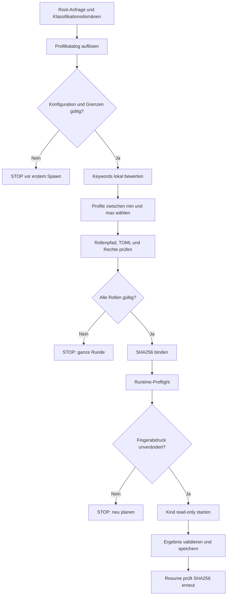

# 08 – Konfigurierbare Workflow-Rollen

## Zweck und Versionsstand

Alpha‑10 erweitert den vorhandenen Zusammenhang zwischen Workflow-Profilen und
Codex-Agentenrollen. Ein Profil bestimmt weiterhin Name, Fachrolle, Modell,
Reasoning-Stufe und Budgets. `agent_type` verweist optional auf eine
`[agents.<name>]`-Definition, deren Rollendatei ausschließlich fachliche
Anweisungen oder strengere Berechtigungen ergänzen darf.

Die Funktion ist im Alpha‑10-Quellstand implementiert. Alpha‑9 enthält sie
nicht. Als installierbares Releaseverhalten ist sie nur belegt, wenn der Tag
`v0.147.1-alpha-10` den Release-Workflow erfolgreich durchlaufen hat.

## Verantwortlichkeiten

| Ebene | Verantwortet | Darf nicht ersetzen |
| --- | --- | --- |
| Workflow-Profil | technische Profil-ID, sichtbare Rolle, Modell, Reasoning, Token- und Kontextbudget, Auswahlbegriffe | Root-Anfrage, Workflow-Gates, Root-Berechtigungen |
| Agentenrolle | fachliche `developer_instructions` und optionale Verschärfungen | Profilmodell, Reasoning, Workflow-Identität, Digest, Quorum oder Ergebnisvertrag |
| Workflow-Laufzeit | Auswahl, Preflight, Read-only-Grenze, Fingerabdruck, Spawn und Resume | vom Projekt angeforderte Berechtigungserweiterungen |

`name` und `role` müssen innerhalb des Experten- beziehungsweise
Reviewerkatalogs ohne Beachtung der Groß-/Kleinschreibung eindeutig sein.

## Basiskatalog ersetzen oder ergänzen

`profiles` behält die bisherige Bedeutung und ersetzt den eingebauten Katalog
des jeweiligen Prozesses vollständig:

```toml
[extended_workflow.experts]
enabled = true
min = 2
max = 2

[[extended_workflow.experts.profiles]]
name = "architecture"
role = "Architecture"
model = "gpt-5.6-sol"
reasoning_effort = "high"

[[extended_workflow.experts.profiles]]
name = "security"
role = "Security and permissions"
model = "gpt-5.6-terra"
reasoning_effort = "xhigh"
```

`additional_profiles` ergänzt dagegen die eingebauten oder explizit ersetzten
Profile in Deklarationsreihenfolge:

```toml
[[extended_workflow.experts.additional_profiles]]
name = "database_migration"
role = "Database migration and data integrity"
agent_type = "database_migration"
selection_keywords = [
  "database",
  "datenbank",
  "schema migration",
  "sql migration",
  "rollback",
]
model = "gpt-5.6-sol"
reasoning_effort = "high"
token_budget = 3200
context_budget = 24000
```

Konfigurationsschichten werden weiterhin nach den allgemeinen Codex-Regeln
zusammengeführt. Arrays aus verschiedenen Schichten werden nicht heimlich
verkettet. Erst nach der Schichtauflösung wird `additional_profiles` an den
wirksamen Basiskatalog angehängt.

## Eigene Rollendatei definieren

Die zugehörige Agentenrolle wird in derselben vertrauenswürdigen
Projektkonfiguration deklariert:

```toml
[agents.database_migration]
description = "Prüft Datenbankmigrationen und Datenintegrität."
config_file = "./agents/database-migration.toml"
```

Die Datei `.codex/agents/database-migration.toml` kann so aussehen:

```toml
developer_instructions = """
Die Rolle prüft Migrationsreihenfolge, Datenintegrität, Rückwärtskompatibilität,
Rollback-Fähigkeit und realistische Verifikation. Belegte Befunde werden von
Empfehlungen getrennt. Als Reviewer verändert die Rolle keine Dateien.
"""

# Optionale Verschärfungen sind zulässig.
approval_policy = "never"
sandbox_mode = "read-only"
web_search = "disabled"
```

Eine projektspezifische Rollendatei muss nach Kanonisierung innerhalb des
vertrauenswürdigen Konfigurationsbereichs liegen. Pfadflucht, nicht auflösbare
Symlink-/Reparse-Ziele und kanonisch erkennbare Ziele außerhalb dieses Bereichs
werden vor dem ersten Spawn abgelehnt.

## Zulässige Rollenschlüssel

Für konfigurierte Extended-Workflow-Rollen akzeptiert der Preflight nur:

- `developer_instructions`;
- `approval_policy = "never"`;
- `sandbox_mode = "read-only"`;
- `web_search = "disabled"`;
- `allow_login_shell = false`;
- `include_apps_instructions = false`;
- `include_collaboration_mode_instructions = false`;
- `include_environment_context = false`.

Andere Schlüssel werden fail-closed abgelehnt. Insbesondere gehören `model`
und `model_reasoning_effort` nicht in die Rollendatei; Modell und
`reasoning_effort` stammen aus dem Workflow-Profil. Eine Rollendatei kann weder
Schreibrechte noch Netzwerk, Freigaben, Kind-Agenten oder Apps aktivieren.

## Lokale deterministische Auswahl

`selection_keywords` steuert die Auswahl ohne zusätzlichen Modellaufruf:

1. Root-Anfrage und Klassifikationsdomänen werden in Unicode-Kleinschreibung
   normalisiert.
2. Satzzeichen und mehrfacher Leerraum in Auswahlbegriffen werden zu
   eindeutigen Wortgrenzen normalisiert.
3. Wörter und Wortfolgen werden an lexikalischen Grenzen verglichen;
   Teiltreffer innerhalb längerer Wörter zählen nicht.
4. Die Anzahl expliziter Treffer entscheidet zuerst.
5. Danach folgen der bestehende Domänen-/Risikoscore und schließlich die
   Deklarationsreihenfolge.
6. Wenn kein Profil Auswahlbegriffe besitzt, bleibt die Alpha‑9-Sortierung
   unverändert.

Die Auswahlbegriffe werden nicht als zusätzliche Rollenanweisung in den
Modellkontext kopiert. Der begrenzte, modell-sichtbare Plan kann jedoch die
tatsächlich passenden Treffer, den Auswahlgrund und die Profilquelle nennen.

## Grenzen

| Gegenstand | Harte Grenze |
| --- | ---: |
| gleichzeitig ausgewählte Profile je Prozess | 6 |
| Profile im Katalog je Prozess | 16 |
| Auswahlbegriffe je Profil | 12 |
| UTF‑8-Größe eines Auswahlbegriffs | 64 Byte |
| UTF‑8-Größe eines kurzen Profilfelds | 256 Byte |
| gesamte Profilmetadaten je Prozess | 16 KiB |
| geschätzte Rollenanweisung je ausgewählter Rolle | 8.000 Token |

Ab mehr als 1.000 geschätzten Tokens erhält die Rolle den
Preflight-Status `manual_review_recommended`. Über 8.000 Tokens oder bei einem
zu kleinen `context_budget` wird die gesamte Runde vor einem Modellaufruf
blockiert. Es findet keine stille Kürzung statt.

## Preflight, Fingerabdruck und Resume

Vor einer Experten- oder Reviewrunde werden alle ausgewählten Profile geprüft:

- `agent_type`, TOML, Herkunft und kanonischer Pfad;
- zulässige Rollenschlüssel und Read-only-Grenze;
- Modell und Reasoning-Stufe gegen den lokalen Modellkatalog;
- Größen- und Kontextgrenzen;
- eindeutige Profilidentitäten;
- SHA‑256-Fingerabdruck der wirksamen Rolle.

Der sichtbare Plan zeigt zwölf Hexzeichen des Rollenfingerabdrucks. Intern wird
der vollständige 64-stellige SHA‑256-Wert an den Kind-Agenten gebunden und in
dessen Sitzungsmetadaten gespeichert. Unmittelbar vor dem Spawn wird die Rolle
erneut aufgelöst und mit dem Plan verglichen. Anschließend wendet die Laufzeit
genau die dabei geprüften Bytes ohne zweiten pfadbasierten Lesevorgang an. Beim
Resume wird der Fingerabdruck ebenfalls neu geprüft. Eine Abweichung stoppt den
Vorgang und verlangt eine neue Planung.

Der Rollenfingerabdruck ergänzt den Working-Tree-Digest. Er ersetzt weder das
Reviewerquorum noch das Same-Digest-Gate.

Die Alpha‑10-Prüfung ist keine vollständige Betriebssystem-Härtung gegen einen
privilegierten Prozess, der den Dateisystem-Namespace genau zwischen
Kanonisierung und Öffnen austauscht. Sie verhindert normale Pfadflucht,
erkennt Inhaltsdrift zwischen Planung, Spawn und Resume und beseitigt den
früher möglichen zweiten Lesevorgang nach der Fingerabdruckprüfung. Rollen
werden deshalb nur aus Konfigurationsbereichen geladen, die nicht von weniger
vertrauenswürdigen Benutzern beschreibbar sind.

## Rollenworkflow

### ASCII

```text
[Root-Anfrage + Klassifikationsdomänen]
                  |
                  v
        [Profilkatalog auflösen]
          profiles + additional_profiles
                  |
                  v
       <Konfiguration und Grenzen gültig?>
          |                         |
        Nein                        Ja
          |                         |
 [STOP vor erstem Spawn]            v
                         [Keywords lokal bewerten]
                                    |
                                    v
                         [min..max Profile wählen]
                                    |
                                    v
                     [Rollenpfad + TOML + Rechte prüfen]
                                    |
                                    v
                         <alle Rollen gültig?>
                           |               |
                         Nein              Ja
                           |               |
                 [STOP ganze Runde]        v
                                  [SHA256 binden]
                                           |
                                           v
                                 [Runtime-Preflight]
                                           |
                                           v
                              <Fingerabdruck unverändert?>
                                  |                |
                                Nein               Ja
                                  |                |
                         [STOP: neu planen]         v
                                           [Kind read-only starten]
                                                    |
                                                    v
                                      [Ergebnis validieren/speichern]
                                                    |
                                                    v
                                     [Resume prüft SHA256 erneut]
```

### Mermaid



Beide Diagramme zeigen denselben Ablauf und dieselben Abbruchpfade. Kein
Kind-Agent startet, wenn Katalog, Rolle, Berechtigungsgrenze oder
Fingerabdruck ungültig sind.

## Typische Fehler

| Fehler | Bedeutung | Korrektur |
| --- | --- | --- |
| `unknown agent_type` | Profil verweist auf keine wirksame Agentenrolle | Schreibweise und `[agents.<name>]` prüfen |
| `outside its trusted configuration directory` | kanonischer Rollenpfad verlässt den erlaubten Bereich | Rollendatei unter dem vertrauenswürdigen Konfigurationsbereich ablegen |
| `role setting ... is not permitted` | Rollendatei versucht ein Profilfeld oder eine Berechtigung zu ersetzen | nur zulässige fachliche Anweisung oder Verschärfung verwenden |
| `changed after preflight` | Rollendatei wurde nach der Planung geändert | Runde neu planen; alten Plan nicht weiterverwenden |
| `hard limit is 8000` | Rollenanweisung ist zu groß | Inhalt fachlich kürzen oder in mehrere klar begrenzte Rollen teilen |
| `cannot fit ... context_budget` | Anfrage und Rolle passen nicht in das Profilfenster | Kontextbudget erhöhen oder Auftrag/Rolle verkleinern |
| zu wenige Profile für `min` | Katalog kann das geforderte Quorum nicht bilden | Katalog ergänzen oder gültige Min-/Max-Werte setzen |

Fehlermeldungen nennen Rolle, Pfad oder Schlüssel, geben aber nicht die
vollständigen Rollenanweisungen aus.

## Bediengrenze von Alpha‑10

Alpha‑10 konfiguriert Rollen über `config.toml` und die vorhandenen
Agentenrollendateien. Ein eigener Slash-Befehl `/workflow-roles` ist nicht
implementiert und wird daher nicht dokumentiert. `/workflow-type` wählt die
Workflow-Art, nicht den Rollenkatalog.

## Weiterführende Dokumentation

- [04 – Konfiguration](04-konfiguration.md)
- [07 – `.codex/config.toml`-Praxisanleitung](07-config-toml-praxisanleitung.md)
- [Konzeptgrundlage für konfigurierbare Rollen](concepts/01-konfigurierbare-workflow-rollen.md)
- [03 – Workflow und Same-Digest-Gate](03-workflow.md)
