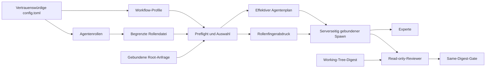

# Konzept: Präzise definierbare und erweiterbare Workflow-Rollen

> **Status:** Kernfunktion im Quellstand für `v0.147.1-alpha-10` implementiert
>
> **Kompatibilitätsbasis:** `v0.147.1-alpha-9`
>
> **Zielrelease für die neue Kernfunktion:**
> `v0.147.1-alpha-10`

## Kurzentscheidung

Das bestehende Rollensystem wird erweitert, aber nicht durch ein zweites
Rollensystem ersetzt:

- Ein **Workflow-Profil** bestimmt Auswahl, Anzeigename, Modell,
  Reasoning-Stufe und Budgets.
- Eine bestehende **Agentenrolle** unter `[agents.<name>]` beschreibt über eine
  eigene Konfigurationsdatei die fachlichen Aufgaben und Grenzen.
- `agent_type` verbindet beide Ebenen.
- Neue additive Profile und explizite Auswahlbegriffe ergänzen die bestehende
  Konfiguration, ohne bestehende Konfigurationen umzudeuten.
- Sicherheitsregeln des Extended Workflow bleiben technisch erzwungen und
  können durch eine Rollendatei nicht gelockert werden.

Für das Anlegen dieses Konzeptdokuments ist **kein neues Release** nötig. Auch
individuelle Rollen mit den Alpha‑9-Feldern `profiles` und `agent_type`
benötigen kein zusätzliches Release. Die neuen Felder und Laufzeitprüfungen
erfordern dagegen eine neue Programmversion und sind im Alpha‑10-Quellstand
implementiert. Ein zusätzliches Release nur für dieses Konzept ist nicht
erforderlich.

## Ausgangslage

### Was Alpha-9 bereits kann

Alpha‑9 unterstützt bereits frei benennbare Experten- und Reviewerprofile. Ein
Profil besitzt insbesondere:

- `name` als eindeutige technische Identität;
- `role` als kurze fachliche Bezeichnung;
- optional `agent_type` als Verweis auf `[agents.<name>]`;
- optional Modell, Reasoning-Stufe, Tokenbudget und Kontextbudget.

Über `[agents.<name>]` kann eine eigene Rollendatei geladen werden. Darin lassen
sich beispielsweise ausführliche `developer_instructions` hinterlegen. Beim
Start eines Workflow-Agenten löst die Laufzeit den im Profil festgelegten
`agent_type` auf und wendet die Rolle auf den Kind-Agenten an.

Damit ist bereits mit Alpha‑9 Folgendes möglich:

```toml
# .codex/config.toml

[agents.database_migration]
description = "Analysiert Datenbank- und Schemamigrationen."
config_file = "./agents/database-migration.toml"

[extended_workflow.experts]
enabled = true
min = 2
max = 3

[[extended_workflow.experts.profiles]]
name = "database_migration"
role = "Database migration and data integrity"
agent_type = "database_migration"
model = "gpt-5.6-sol"
reasoning_effort = "high"
context_budget = 24000

# Alle weiteren gewünschten Profile müssen ebenfalls aufgeführt werden.
```

```toml
# .codex/agents/database-migration.toml

developer_instructions = """
Die Rolle prüft Schemaänderungen, Vorwärts- und Rückwärtsmigrationen,
Sperrverhalten, Datenintegrität und Wiederanlauf. Sie benennt Annahmen und
liefert konkrete Fundstellen. Bei einem Start als Reviewer verändert sie keine
Dateien.
"""
```

Diese Syntax ist keine neue Funktion dieses Konzepts. Sie verwendet die in
Alpha-9 vorhandene Verbindung über `agent_type`.

### Grenzen von Alpha‑9

Alpha‑9 besitzt vier Grenzen, die das Hinzufügen eigener Rollen
unnötig fehleranfällig machen:

1. Sobald `profiles` angegeben ist, ersetzt die Liste alle eingebauten Profile.
   Sie ergänzt sie nicht. Ein vermeintlich „zusätzliches“ Profil kann daher
   unbemerkt die Standardrollen verdrängen.
2. Profilkatalog und maximale Zahl gleichzeitig gestarteter Agenten verwenden
   dieselbe Obergrenze von sechs. Es können deshalb nicht beispielsweise zwölf
   mögliche Fachrollen konfiguriert und davon dynamisch drei ausgewählt werden.
3. Die automatische Auswahl erkennt nur fest eingebaute Begriffe für
   Architektur, Security, Tests, CLI/UX, Daten und Nebenläufigkeit. Eine Rolle
   wie „Barrierefreiheit“ oder „Lizenzkonformität“ ist konfigurierbar, wird aber
   ohne passenden eingebauten Begriff nicht zuverlässig priorisiert.
4. Ein unbekannter oder zwischen Planung und Start veränderter `agent_type`
   wird erst beim Start des einzelnen Agenten sichtbar. Für einen formalen
   Workflow ist eine gemeinsame Vorabprüfung stabiler.

## Ziele

Das Zielbild soll:

- bestehende Alpha-9-Profilkonfigurationen und ihre Auswahlreihenfolge ohne
  neue Felder unverändert weiterverwenden;
- Standardprofile sicher um projektspezifische Profile ergänzen;
- ausführliche, wiederverwendbare Rollendefinitionen ermöglichen;
- neue Fachrollen ohne Änderung eines fest codierten Klassifikators sinnvoll
  auswählen;
- Auswahl und Rolleninhalte deterministisch und auditierbar machen;
- Kontext- und Ressourcenverbrauch hart begrenzen;
- Reviewer weiterhin an Root-Anfrage, Arbeitsstand und Same-Digest-Gate binden;
- Berechtigungen niemals durch eine Rollendatei erweitern;
- Konfigurationsfehler vor dem Start einer Experten- oder Reviewrunde melden.

## Nichtziele

Dieses Konzept führt bewusst nicht ein:

- frei formulierbare Inline-Prompts direkt in jedem Workflow-Profil;
- reguläre Ausdrücke oder ausführbaren Code für die Rollenauswahl;
- unbegrenzt viele Rollen oder gleichzeitig laufende Agenten;
- eine Möglichkeit, Read-only-, Berechtigungs- oder Same-Digest-Regeln zu
  überschreiben;
- eine automatische Aussage, dass eine fachlich passende Rolle formal als
  Pflicht-Experte oder Pflicht-Reviewer gültig ist;
- einen Releasebau allein wegen einer Dokumentationsänderung.

## Begriffe und Verantwortlichkeiten

| Begriff | Aufgabe | Modell-sichtbarer Inhalt |
| --- | --- | --- |
| Workflow-Profil | Auswahl, Identität, Modell und Budgets | kurzer Name und kurze Rolle des ausgewählten Profils |
| Agentenrolle | ausführliche fachliche Arbeitsanweisung | aufgelöste `developer_instructions` des ausgewählten `agent_type` |
| Prozess | Regeln für Experten oder Reviewer | Min/Max, Budget und ausgewählte Profile |
| Rollenfingerabdruck | bindet Planung an eine konkrete Rollendefinition | nur Kennung und SHA-256, nicht die gesamte Datei |
| kanonische Aufgabe | bindet Kind-Agent an Root-Anfrage und Workflow-Gates | ja, hart begrenzt |

Die Trennung ist sicherheitsrelevant: Die fachliche Rolle darf den Auftrag
präzisieren. Die Laufzeit bleibt Eigentümerin von Berechtigungen,
Workflow-Identität, Read-only-Zustand, Arbeitsstand-Digest und Abschluss-Gates.

## Zielarchitektur



Terminalfreundliche Darstellung:

```text
[VERTRAUENSWÜRDIGE KONFIGURATION]
       |                         |
       v                         v
[WORKFLOW-PROFILE] -----> [AGENTENROLLE + ROLLENDATEI]
       |                         |
       +-----------+-------------+
                   v
        [PREFLIGHT + AUSWAHL] <----- [GEBUNDENE ROOT-ANFRAGE]
              |              |
              v              v
 [ROLLENFINGERABDRUCK] [EFFEKTIVER AGENTENPLAN]
              |              |
              +------+-------+
                     v
          [SERVERSEITIG GEBUNDENER SPAWN]
                 /                  \
                v                    v
           [EXPERTE]         [READ-ONLY-REVIEWER] <--- [WORKING-TREE-DIGEST]
                                      |
                                      v
                             [SAME-DIGEST-GATE]
```

## Implementiertes Konfigurationsmodell

### Bestehende Felder bleiben erhalten

`profiles` behält exakt seine bisherige Bedeutung: Wenn die Liste vorhanden
ist, ersetzt sie die eingebauten Profile dieses Prozesses. Bestehende
Konfigurationen dürfen durch ein Update weder ergänzt noch neu sortiert werden.

Auch die vorhandenen Profilfelder bleiben semantisch stabil:

| Feld | Bedeutung |
| --- | --- |
| `name` | eindeutige technische Profilidentität |
| `role` | kurze, eindeutige Anzeige- und Aufgabenbezeichnung |
| `agent_type` | Verweis auf eine bestehende `[agents.<name>]`-Definition |
| `model` | gewünschtes Modell für das Profil |
| `reasoning_effort` | gewünschte Reasoning-Stufe |
| `token_budget` | beratendes Profilbudget |
| `context_budget` | harte Kontextobergrenze des Kind-Agenten |

### Neues Feld `additional_profiles`

`additional_profiles` ergänzt den wirksamen Basiskatalog:

1. Ist `profiles` nicht angegeben, bilden die eingebauten Profile die Basis.
2. Ist `profiles` angegeben, bildet diese explizite Liste die Basis.
3. Danach werden `additional_profiles` in Deklarationsreihenfolge angehängt.
4. Doppelte Namen oder Rollen werden ohne Start eines Agenten abgelehnt.
5. Die normalen Regeln der Konfigurationsschichten werden vor dieser Auflösung
   angewendet. Arrays aus unterschiedlichen Schichten werden nicht heimlich
   miteinander verkettet.

Damit ist sowohl ein vollständiger Ersatz als auch eine sichere Ergänzung
möglich, ohne die Bedeutung von `profiles` zu ändern.

### Neues Feld `selection_keywords`

Ein Profil kann lokale Auswahlbegriffe definieren. Sie beeinflussen nur die
deterministische Auswahl und werden nicht als zusätzliche Rollenanweisung in
den Modellkontext kopiert. Tatsächlich passende Begriffe können als begrenzte
Auswahldiagnose im Workflow-Plan erscheinen.

```toml
# Ab Alpha-10 unterstützt; Alpha-9 lehnt diese Felder als unbekannt ab.

[agents.database_migration]
description = "Prüft Datenbankmigrationen und Datenintegrität."
config_file = "./agents/database-migration.toml"

[[extended_workflow.experts.additional_profiles]]
name = "database_migration"
role = "Database migration and data integrity"
agent_type = "database_migration"
selection_keywords = [
  "database",
  "datenbank",
  "schema migration",
  "sql migration",
  "rollback",
]
model = "gpt-5.6-sol"
reasoning_effort = "high"
token_budget = 3200
context_budget = 24000

[[extended_workflow.reviewers.additional_profiles]]
name = "accessibility_review"
role = "Accessibility and inclusive user experience"
agent_type = "accessibility_review"
selection_keywords = [
  "accessibility",
  "barrierefreiheit",
  "screen reader",
  "keyboard navigation",
  "wcag",
]
model = "gpt-5.6-terra"
reasoning_effort = "high"
context_budget = 20000
```

Die Rollenanweisungen bleiben in eigenen Dateien:

```toml
# .codex/agents/accessibility-review.toml

developer_instructions = """
Die Rolle prüft Bedienbarkeit ohne Maus, Fokusreihenfolge, verständliche
Beschriftungen, semantische Zustände und Screenreader-Ausgaben. Sie trennt
belegte Befunde von Empfehlungen und verändert als Reviewer keine Dateien.
"""
```

### Harte Größenlimits

Die folgenden konservativen Grenzen werden im Alpha‑10-Quellkandidaten
erzwungen:

| Gegenstand | Implementierte Grenze |
| --- | ---: |
| gleichzeitig ausgewählte Profile je Prozess | weiterhin höchstens 6 |
| Profile im auswählbaren Katalog je Prozess | höchstens 16 |
| Auswahlbegriffe je Profil | höchstens 12 |
| UTF-8-Größe eines Auswahlbegriffs | höchstens 64 Byte |
| bestehende kurze Profilfelder | weiterhin höchstens 256 Byte |
| gesamte Profilmetadaten je Prozess | höchstens 16 KiB |
| aufgelöste Rollenanweisung je ausgewählter Rolle | höchstens 8.000 Token |

Bei mehr als 1.000 Token Rollenanweisung weist die Validierung zusätzlich auf eine
manuelle Kontextprüfung hin. Der Preflight schätzt den vollständigen
servergebundenen Aufgabenvertrag zusammen mit der Rollenanweisung und lehnt
diese Kombination ab, wenn sie das Profil-`context_budget` überschreitet. Das
Budget begrenzt außerdem das lokale Kontextfenster des Kind-Agenten; weitere
System- und Laufzeitfragmente unterliegen darin der normalen
Codex-Kontextverwaltung und der gegebenenfalls kleineren Modellgrenze. Der
Aufgabenvertrag oder die Rollenanweisung werden nicht still gekürzt.

Die Trennung von Kataloggröße und Gleichzeitigkeit erlaubt mehr Fachrollen,
ohne Thread-, Token- oder Speicherverbrauch automatisch zu erhöhen.

## Deterministische Rollenauswahl

Die Auswahl bleibt lokal; sie löst keinen zusätzlichen Modellaufruf aus.

1. Root-Anfrage und vorhandene Klassifikationsdomänen werden normalisiert.
2. `selection_keywords` werden ohne Regex, Glob oder Codeausführung als Wörter
   beziehungsweise Wortfolgen verglichen.
3. Profile werden zuerst nach Anzahl passender expliziter Auswahlbegriffe,
   danach mit dem bestehenden Domänen- und Risikoscore und zuletzt nach ihrer
   Deklarationsreihenfolge sortiert.
4. Besitzt kein Profil Auswahlbegriffe, wird der bestehende Alpha-9-Algorithmus
   unverändert verwendet.
5. Das Ergebnis protokolliert pro ausgewähltem Profil nur die Trefferbegriffe,
   Scorebestandteile und Quelle. Rollenanweisungen werden nicht vollständig in
   Statusausgaben oder Logs wiederholt.

Für den Vergleich gelten Unicode-Kleinschreibung sowie normalisierte
Wortgrenzen aus Leerraum und Satzzeichen. Substring-Treffer innerhalb
beliebiger Wörter sind nicht zulässig. Dadurch wird beispielsweise `sql` nicht
zufällig in einem unabhängigen längeren Wort erkannt; semantisch gleiche
Varianten wie `schema-migration` und `schema migration` zählen nicht doppelt.

Die Auswahl ist eine Eignungsentscheidung, noch kein formaler Nachweis. Ein
ausgewähltes Profil ist erst dann formal gültig, wenn der Agent tatsächlich
gestartet wurde, inhaltlich geantwortet hat und alle Workflow-Gates erfüllt.

## Sichere Rollenauflösung und Preflight

Vor einer Experten- oder Reviewrunde wird der vollständige Plan geprüft:

1. Alle ausgewählten `agent_type`-Namen sind bekannt.
2. Alle referenzierten Rollendateien sind lesbar und gültiges TOML.
3. Konfigurationsquelle und kanonischer Pfad sind vertrauenswürdig.
4. Größen-, Kontext-, Modell- und Reasoning-Grenzen sind gültig.
5. Namen und Rollen sind pro Prozess ohne Beachtung der Groß-/Kleinschreibung
   eindeutig.
6. Die wirksamen Berechtigungen sind mindestens so streng wie die der
   Root-Sitzung und des Workflow-Typs.
7. Für jede aufgelöste Rolle wird ein SHA-256-Fingerabdruck berechnet.

Der Fingerabdruck bindet mindestens:

- den technischen `agent_type`;
- Quelle und kanonischen Pfad der Rollendatei;
- die relevanten Bytes der aufgelösten Rollenkonfiguration;
- die wirksamen sicherheitsrelevanten Einschränkungen.

Zwischen Planung und Spawn wird erneut aufgelöst. Ändert sich der
Fingerabdruck, startet kein Kind-Agent. Der Workflow verlangt einen neuen Plan.
Die Laufzeit wendet anschließend genau die dabei validierten Bytes an und liest
den Pfad nicht nach der Fingerabdruckprüfung ein zweites Mal. Dasselbe
Fingerabdruck-Gate gilt beim Resume und vor einer formalen Reviewrunde. Das ist
besonders wichtig für Benutzerrollendateien außerhalb des Git-Arbeitsbaums,
weil deren Änderung nicht im Working-Tree-Digest enthalten wäre.

## Sicherheitsmodell

### Nicht überschreibbare Grenzen

Eine Rollendatei darf Fachwissen ergänzen, aber folgende Werte niemals
erweitern oder ersetzen:

- Root-Anfrage und deren SHA-256-Bindung;
- Workflow-Art und Profilidentität;
- Read-only-Zwang für Reviewer;
- Working-Tree-Digest und Same-Digest-Prüfung;
- Sandbox-, Dateisystem-, Netzwerk- und Freigabegrenzen der Root-Sitzung;
- maximale Kind-Tiefe, Parallelität und Workflowbudgets;
- serverseitig festgelegte Modell- und Reasoning-Werte des Profils;
- gefordertes Ergebnisformat und Abschluss-Gates.

Die effektive Berechtigung ist immer die strengere Schnittmenge aus Root-,
Workflow- und Rollenbeschränkung. Fordert eine Rolle weitergehende Rechte an,
wird der Spawn abgelehnt. Eine strengere Rolle, beispielsweise ohne Netzwerk,
bleibt erlaubt.

### Vertrauensgrenzen für Rollendateien

- Projektrollen werden nur aus einer ausdrücklich vertrauenswürdigen
  Projektkonfiguration geladen.
- Relative Projektpfade müssen nach Kanonisierung innerhalb des
  vertrauenswürdigen Projekts bleiben; Pfadflucht, nicht auflösbare Ziele und
  kanonisch erkennbare Reparse-/Symlink-Ziele außerhalb dieser Grenze werden
  abgelehnt.
- Benutzerrollen dürfen aus der vertrauenswürdigen Benutzerkonfiguration und
  deren Rollenverzeichnis stammen.
- Eine Projektkonfiguration darf nicht still eine beliebige Benutzer- oder
  Systemdatei als Rollenanweisung einlesen.
- Geheimnisse gehören weder in Profile noch in Rollendateien. Inhalte werden
  nicht vollständig in Telemetrie, Fehler oder Statuskarten geschrieben.

### Bedrohungen und Gegenmaßnahmen

| Risiko | Gegenmaßnahme |
| --- | --- |
| Rolle versucht Workflow-Regeln zu überschreiben | serverseitige, nicht überschreibbare Identität und Berechtigungsmonotonie |
| Rolle ändert sich nach der Planung | Fingerabdruckvergleich und verpflichtende Neuplanung |
| Tippfehler bei `agent_type` | vollständiger Preflight vor dem ersten Spawn |
| sehr große Rollen oder Kataloge | harte Einzel-, Aggregat- und Kontextlimits |
| absichtlich breite Auswahlbegriffe | Wort-/Phrasenvergleich, Trefferdiagnose und feste Grenzen |
| Rolle verdrängt unbemerkt Standards | explizite Trennung zwischen `profiles` und `additional_profiles` |
| externer Rollenpfad liest sensible Daten | Provenienzprüfung und kanonische Pfadgrenzen |
| Reviewer prüft einen anderen Stand | vorhandenes Same-Digest-Gate plus Rollenfingerabdruck |

Eine vollständige Abwehr gegen einen privilegierten lokalen Prozess, der den
Dateisystem-Namespace genau zwischen Kanonisierung und Öffnen austauscht, liegt
außerhalb des Alpha‑10-Umfangs. Der verbleibende Plattform-Race wird durch
vertrauenswürdige, nicht von weniger privilegierten Benutzern beschreibbare
Konfigurationsverzeichnisse begrenzt. Der normale Inhaltswechsel zwischen
Planung, Spawn und Resume wird dagegen fail-closed erkannt.

## Fehlerverhalten

Die Erweiterung arbeitet fail-closed:

| Situation | Verhalten |
| --- | --- |
| unbekannter `agent_type` | Prozess vor dem ersten Spawn blockieren und Profil nennen |
| doppelter Name oder doppelte Rolle | Konfiguration ablehnen und beide Quellen nennen |
| Katalog oder Metadaten zu groß | Konfiguration mit gemessener und erlaubter Größe ablehnen |
| Rolleninhalt überschreitet Kontextbudget | Prozess blockieren; keine stille Kürzung |
| Rollenfingerabdruck hat sich geändert | Plan verwerfen und Neuplanung verlangen |
| Rolle würde Berechtigung erweitern | Spawn blockieren und betroffene Berechtigungsart nennen |
| kein Auswahlbegriff passt | stabil auf bestehenden Domänenscore und Reihenfolge zurückfallen |
| nicht genug gültige Profile für `min` | Prozess blockieren; niemals mit kleinerem Quorum fortfahren |

Eine Fehlermeldung darf Pfad und technische Rolle nennen, aber keine komplette
Rollenanweisung oder darin versehentlich enthaltene Geheimnisse ausgeben.

## Bedienkonzept

### Kernumfang für Alpha‑10

Der erste Umsetzungsschritt benötigt keine neue TUI-Oberfläche. Konfiguration,
Preflight und bestehende Statusausgaben reichen aus, wenn der Plan zusätzlich
anzeigt:

- ausgewählte Rolle und `agent_type`;
- Konfigurationsquelle;
- gekürzten Rollenfingerabdruck;
- Auswahlgrund beziehungsweise passende Begriffe;
- Preflight-Status.

### Nicht in Alpha‑10 enthaltene Komfortfunktion

Ein eigenständiger Befehl wie `/workflow-roles` könnte folgende rein lokale
Ansichten anbieten:

- `list`: effektiven Experten- und Reviewerkatalog anzeigen;
- `validate`: alle Profile und referenzierten Rollen vorprüfen;
- `explain <text>`: deterministische Auswahl für einen Text erklären;
- `show <name>`: Metadaten und Fingerabdruck, aber keine Geheimnisse anzeigen.

Diese Oberfläche ist kein Bestandteil von Alpha‑10. Eine Umsetzung benötigt
TUI-Snapshot-Tests und ein eigenes nachfolgendes Release.

## Implementierungszuschnitt

### Stufe A: Dokumentation des vorhandenen Verhaltens

- vollständiges Beispiel für `[agents.<name>]`, Rollendatei und `agent_type`;
- deutlich erklären, dass `profiles` die Standardliste ersetzt;
- sichere Hinweise für Rolleninhalt, Pfade und Geheimnisse.

Diese Stufe verändert keine Binärdatei und benötigt kein neues Release.

### Stufe B: Abwärtskompatible Kernfunktion

- `additional_profiles` in der Konfigurationsstruktur ergänzen;
- `selection_keywords` mit harten Grenzen ergänzen;
- Kataloggrenze von Ausführungsgrenze trennen;
- gemeinsamen Preflight und Rollenfingerabdruck einführen;
- Auswahlgründe strukturiert im vorhandenen Workflow-Plan ausgeben;
- Kontextrechnung um aufgelöste Rollenanweisungen erweitern.

Neue Auswahl- und Preflight-Logik gehört wegen der Größe der vorhandenen
Core-Datei in ein eigenes Modul, nicht als weiterer großer Block in
`core/src/extended_workflow.rs`. Konfigurationsauflösung und -grenzen bleiben im
`config`-Crate. Die bestehende Agentenrollenauflösung wird wiederverwendet.

Stufe B verändert Konfigurationsschema und Laufzeitverhalten. Sie ist deshalb
Bestandteil der Binärversion und des Quellstands für
`v0.147.1-alpha-10`. Ein Alpha‑10-Paket ohne diese Stufe würde den
dokumentierten Releasevertrag nicht erfüllen.

### Stufe C: Optionale TUI- und CLI-Unterstützung

- `/workflow-roles list|validate|explain|show`;
- vorbereitete Konfigurationsvorlage mit kommentierten Beispielen;
- kompakte Statusanzeige für Auswahlgrund und Rollenfingerabdruck.

Diese Stufe ist getrennt landbar und ebenfalls releasepflichtig.

## Tests und Abnahmekriterien

### Konfiguration und Rückwärtskompatibilität

- Eine unveränderte Alpha-9-Profilkonfiguration ohne neue Auswahlbegriffe ergibt
  dieselben effektiven Profile in derselben Reihenfolge. Eine bisher
  mehrzweckige Rollendatei mit erweiterten Laufzeit- oder Berechtigungsschlüsseln
  muss für den Extended Workflow in eine sichere Fachrolle aufgeteilt werden.
- `profiles` ersetzt weiterhin die Standardprofile.
- `additional_profiles` ergänzt die wirksame Basis deterministisch.
- Doppelte Namen und Rollen über Basis und Ergänzung werden abgelehnt.
- Grenzen für Katalog, Felder, Auswahlbegriffe und Aggregatgröße werden mit
  präzisen Fehlern geprüft.
- Das generierte Config-Schema wird mit `just write-config-schema` aktualisiert.
- Alpha-9 lehnt die neuen Felder weiterhin als unbekannt ab; die Dokumentation
  kennzeichnet deshalb die erste unterstützte Releaseversion ausdrücklich.

### Auswahl

- Profile ohne `selection_keywords` werden exakt wie bisher sortiert.
- Eine neue Fachrolle wird bei passenden deutschen und englischen Begriffen
  bevorzugt.
- Wortgrenzen verhindern zufällige Teiltreffer.
- Gleichstände werden stabil über vorhandenen Score und
  Deklarationsreihenfolge aufgelöst.
- Auswahlbegriffe werden nicht zu Rollenanweisungen; nur tatsächlich passende
  Begriffe dürfen in der größenbegrenzten Plandiagnose erscheinen.

### Agentenlogik und Sicherheit

- Ein Integrationstest weist nach, dass die aufgelösten
  `developer_instructions` beim vorgesehenen Kind-Agenten ankommen.
- Ein unbekannter `agent_type` blockiert die ganze Runde vor jedem Spawn.
- Eine Rollendatei kann Sandbox, Freigabemodus oder Read-only-Zustand nicht
  lockern.
- Eine Änderung der Rollendatei zwischen Planung und Spawn erzwingt eine neue
  Planung.
- Ein Reviewer bleibt an denselben Working-Tree-Digest gebunden; der
  Rollenfingerabdruck wird zusätzlich geprüft.
- Resume prüft gespeicherte Profilidentität und Fingerabdruck erneut.
- Zu große Rollenanweisungen scheitern vor einem Modellaufruf.

Für Änderungen an Agentenlogik sind Integrationstests mit den vorhandenen
Codex-Testhilfen erforderlich. Falls TUI-Ausgaben geändert werden, sind die
zugehörigen `insta`-Snapshots verpflichtend. Plattformabhängige Pfadauflösung
muss auf Linux, macOS und Windows geprüft werden.

## Releasebewertung

| Änderung | Neuer Build? | Releasebedarf beziehungsweise Ziel | Begründung |
| --- | ---: | ---: | --- |
| nur dieses Konzeptdokument | Nein | Nein | keine ausführbare Datei geändert |
| Dokumentation für vorhandene `profiles`/`agent_type`-Nutzung | Nein | Nein | Funktion ist bereits in Alpha-9 vorhanden |
| projektspezifische Rollen nur mit Alpha‑9-Feldern konfigurieren | Nein | Nein | reine Laufzeitkonfiguration innerhalb der Alpha-9-Grenzen |
| `additional_profiles` oder `selection_keywords` implementieren | Ja | Alpha-10 | neues Config-Schema und neues Laufzeitverhalten |
| Preflight, Fingerabdruck und neue Sicherheitsgrenzen implementieren | Ja | Alpha-10 | Core- und Spawn-Verhalten ändern sich |
| `/workflow-roles` implementieren | Ja | späteres Release | neue TUI-/CLI-Funktion |

### Releasegrenze

Der Quellkandidat verwendet die Workspace-Version `0.147.1-alpha-10`. Diese
Versionsangabe und der Branchname sind allein noch kein Releasebeleg. Erst ein
zur Cargo-Version passender Tag, der den vollständigen Releaseworkflow
erfolgreich durchlaufen hat, macht die Funktion als Alpha‑10-Paket
installierbar.

Daraus folgt:

- Für das Konzept allein wird **kein Release gebaut**.
- Die implementierte Kernfunktion darf nicht als in Alpha-9 verfügbar
  dokumentiert werden.
- Stufe B ist in den Releasekandidaten `v0.147.1-alpha-10` aufgenommen. Ein
  zusätzliches Release nur für die Rollenfunktion ist nicht nötig.
- Die Workspace-Version und der passende Alpha‑10-Tag müssen exakt
  zusammenpassen. Der Branchname `feature/alpha-10` allein ist kein
  Releasebeleg.
- Ein Release darf nur von einem sauberen, exakt geprüften Commit mit zur
  Cargo-Version passendem Tag gebaut werden.

Der vorhandene Releaseworkflow startet bei einem `v*`-Tag, prüft Tag gegen die
Workspace-Cargo-Version, baut das Windows-x64-Paket, erzeugt Prüfsummen,
installiert und smoke-testet das Paket und veröffentlicht die Assets erst nach
bestandenen Gates. Für eine Umsetzung dieses Konzepts bleiben zusätzlich
projektspezifische Tests, Schemaaktualisierung, Lints, formale Reviews und die
Prüfung des exakten Releasekandidaten erforderlich.

## Umgesetzte Entscheidung

1. Dieses Dokument bleibt Architektur- und Sicherheitsgrundlage.
2. Die vorhandene `agent_type`-Nutzung ist in der Bedienungsdokumentation
   beschrieben.
3. Stufe B bildet ein zusammenhängendes Produktinkrement aus
   `additional_profiles`, `selection_keywords`, getrennter Kataloggrenze,
   Preflight und Rollenfingerabdruck.
4. `/workflow-roles` bleibt eine spätere eigenständige UX-Stufe und ist nicht
   Bestandteil dieses Alpha‑10-Kandidaten.
5. Der Releaseprozess darf `v0.147.1-alpha-10` nur nach Tests und formaler
   Prüfung bauen; nicht allein wegen dieses Konzepts und nicht als ungetaggten
   Build.

## Technische Bezugspunkte

- [Konfiguration des Extended Workflow](../04-konfiguration.md)
- [Praxisanleitung für `config.toml`](../07-config-toml-praxisanleitung.md)
- [technischer Workflow-Vertrag](../../../EXTENDED_WORKFLOW.md)
- [bestehende Profilstruktur](../../../codex-rs/config/src/extended_workflow.rs)
- [bestehende Agentenrollenstruktur](../../../codex-rs/config/src/config_toml.rs)
- [bestehende Auswahl- und Planungslogik](../../../codex-rs/core/src/extended_workflow.rs)
- [bestehende Rollenauflösung](../../../codex-rs/core/src/agent/role.rs)
- [Releaseworkflow](../../../.github/workflows/extended-workflow-release.yml)
