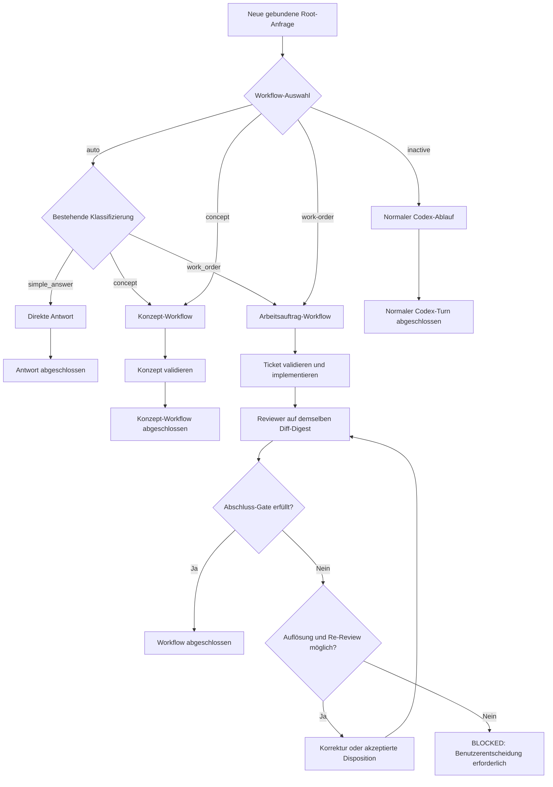

# Konzept: Workflow-Typ und eindeutige Statusausgaben

> **Status:** Die Erweiterung ist im Quellstand für
> `v0.147.1-alpha-10` implementiert. Alpha‑9 enthält sie nicht. Als
> installierbares Releaseverhalten ist sie nur belegt, wenn der Alpha‑10-Tag
> den Release-Workflow erfolgreich durchlaufen hat.

## Ziel

Die erweiterte CLI löst damit zwei Aufgaben besser:

1. Der Benutzer kann vorgeben, ob eine Anfrage automatisch klassifiziert, als
   Konzept, als Arbeitsauftrag oder ohne Extended Workflow verarbeitet wird.
2. Die TUI erklärt Laufzeit, Validierung, Ergebnis-Gate und Gesamtquorum so
   eindeutig, dass gleichzeitig sichtbare Zustände wie `PASS`, `ELIGIBLE`,
   `BLOCKED` und `Closed` nicht wie Widersprüche wirken.

Die bestehende automatische Klassifizierung, Tokenabrechnung, Experten- und
Reviewer-Konfiguration sowie das Same-Digest-Gate bleiben erhalten.

## Begriffe und Datenmodell

Die vorhandenen drei **Anfrageklassen** bleiben unverändert:

| Anfrageklasse | Bedeutung |
| --- | --- |
| `simple_answer` | direkte Antwort, normalerweise ohne Experten |
| `concept` | beratener Konzeptprozess, noch keine Implementierung |
| `work_order` | Ticket, Implementierung, Tests und Reviewer-Gate |

Neu ist eine vorgelagerte **Workflow-Auswahl**. Sie bestimmt, ob die Klasse
automatisch ermittelt oder ausdrücklich vorgegeben wird:

| Technischer Wert | Deutsche Anzeige | Wirkung |
| --- | --- | --- |
| `auto` | Auto | bestehende Klassifizierung wählt eine der drei Anfrageklassen |
| `inactive` | Inaktiv | normaler Codex-Ablauf ohne automatische Extended-Workflow-Gates |
| `concept` | Konzept | effektive Anfrageklasse wird `concept` |
| `work-order` | Arbeitsauftrag | effektive Anfrageklasse wird `work_order` |

Der im ursprünglichen Vorschlag genannte Wert `inaktive` wird nicht als
kanonischer technischer Wert verwendet. Für Konfiguration und Befehlsargumente
ist `inactive` eindeutig; die deutsche TUI zeigt grammatikalisch korrekt
`inaktiv` beziehungsweise `Inaktiv` an.

`simple_answer` wird bewusst nicht als erzwungene Auswahl angeboten. Diese
Klasse bleibt ein Ergebnis von `auto`. Wer den Extended Workflow für kommende
Anfragen umgehen möchte, wählt ausdrücklich `inactive`.

Die Implementierung verwendet deshalb zwei getrennte Werte:

- `workflow_type`: die vom Benutzer oder aus der Konfiguration
  gewählte Steuerung;
- `effective_request_class`: die für den gebundenen Turn tatsächlich
  verwendete Anfrageklasse oder `None` bei `inactive`.

Bei `concept` und `work-order` berechnet der vorhandene Klassifikator weiterhin
Risiko, Fachgebiete, Unsicherheit und Komplexität. Nur seine Klassenentscheidung
wird überschrieben. Dadurch bleiben Auswahl und Anzahl passender Experten und
Reviewer dynamisch.

## Ablauf



Dasselbe Diagramm als terminalfreundliche ASCII-Fassung:

```text
[NEUE GEBUNDENE ROOT-ANFRAGE]
              |
              v
     {AUSGEWÄHLTER WORKFLOW-TYP}
              |
              +-- auto ------> {BESTEHENDE KLASSIFIZIERUNG}
              |                    |
              |                    +-- simple_answer --> [DIREKTE ANTWORT]
              |                    |                              |
              |                    |                              v
              |                    |                    [ANTWORT ABGESCHLOSSEN]
              |                    |
              |                    +-- concept --------> (K)
              |                    |
              |                    +-- work_order -----> (W)
              |
              +-- inactive --> [NORMALER CODEX-ABLAUF]
              |                         |
              |                         v
              |                [NORMALER CODEX-TURN ABGESCHLOSSEN]
              |
              +-- concept -----------------------------> (K)
              |
              +-- work-order --------------------------> (W)

(K) --> [KONZEPT-WORKFLOW] --> [KONZEPT VALIDIEREN]
                                      |
                                      v
                          [KONZEPT-WORKFLOW ABGESCHLOSSEN]

(W) --> [ARBEITSAUFTRAG-WORKFLOW]
              |
              v
     [TICKET VALIDIEREN UND IMPLEMENTIEREN]
              |
              v
     [REVIEWER AUF DEMSELBEN DIFF-DIGEST]
              |
              v
     {ABSCHLUSS-GATE ERFÜLLT?}
          |                  |
         Ja                 Nein
          |                  |
          v                  v
[WORKFLOW ABGESCHLOSSEN] {AUFLÖSUNG UND RE-REVIEW MÖGLICH?}
                                  |                    |
                                 Ja                   Nein
                                  |                    |
                                  v                    v
                    [KORREKTUR ODER AKZEPTIERTE   [BLOCKED:
                     DISPOSITION]                  BENUTZERENTSCHEIDUNG]
                                  |
                                  +--> zurück zu den Reviewern
```

## Verhalten der vier Auswahlwerte

Eine Auswahl gilt ab der nächsten Root-Anfrage für alle folgenden
Root-Anfragen derselben Sitzung, bis der Benutzer sie erneut ändert. Sie ist
also kein einmaliger Schalter.

### `auto`

- ist der Standard für eine neue Sitzung;
- verwendet die bestehende Klassifizierung unverändert;
- kann `simple_answer`, `concept` oder `work_order` ergeben;
- zeigt die effektive Klasse zusätzlich in `/status`, damit eine automatische
  Entscheidung nachvollziehbar bleibt.

### `inactive`

- deaktiviert die automatische Extended-Workflow-Orchestrierung für kommende
  Root-Anfragen;
- startet keine verpflichtenden Experten oder Reviewer;
- erzeugt kein neues Extended-Workflow-Budget und kein Same-Digest-Gate;
- deaktiviert weder den normalen Codex-Agenten noch Werkzeuge oder ausdrücklich
  vom Benutzer angeforderte Standardfunktionen;
- verwirft niemals stillschweigend einen bereits aktiven Workflow.

### `concept`

- setzt die effektive Anfrageklasse für die nächste gebundene Root-Anfrage auf
  `concept`;
- verwendet die konfigurierten Expertenregeln;
- erzeugt ein validiertes Konzept und optional Ticketvorschläge;
- beginnt keine Implementierung, bis der Benutzer zu `work-order` wechselt oder
  unter `auto` ausdrücklich einen Arbeitsauftrag erteilt.

### `work-order`

- setzt die effektive Anfrageklasse auf `work_order`;
- verwendet die konfigurierten Experten- und Reviewerregeln;
- verlangt ein umsetzbares Ticket mit Akzeptanzkriterien;
- führt nach Implementierung und Tests das bestehende Same-Digest-Gate aus.

Eine erzwungene Klasse überschreibt nicht die unabhängigen Schalter
`extended_workflow.experts.enabled` und
`extended_workflow.reviewers.enabled`. Deaktivierte Prozesse bleiben
deaktiviert.

## Bedienkonzept für `/workflow-type`

Ohne Argument öffnet `/workflow-type` eine Auswahlliste:

```text
Workflow-Typ auswählen

  Auto                 Anfrage automatisch klassifizieren
  Inaktiv              Extended Workflow für neue Anfragen umgehen
  Konzept              Konzept-Workflow erzwingen
  Arbeitsauftrag       Arbeitsauftrag-Workflow erzwingen
```

Der aktuell ausgewählte Eintrag wird markiert. Nach der Auswahl bestätigt die
TUI den technischen Wert, zum Beispiel:

```text
Workflow-Typ auf concept gesetzt. Gilt ab der nächsten Root-Anfrage.
```

Für reproduzierbare Bedienung unterstützt derselbe Parser zusätzlich diese
Formen:

```text
/workflow-type auto
/workflow-type inactive
/workflow-type concept
/workflow-type work-order
```

Fehlerhafte Werte werden mit der vollständigen Liste gültiger Werte
zurückgewiesen.

### Wechsel bei einem aktiven Workflow

Die Auswahl darf keinen laufenden Nachweis umgehen:

- Während ein Turn ausgeführt wird, ist `/workflow-type` nicht verfügbar.
- Ist eine Workflow-Generation noch offen, wird der Typwechsel abgelehnt und
  nicht für später vorgemerkt.
- Der Benutzer muss den Workflow regulär abschließen oder ihn ausdrücklich mit
  `/workflow-reset-budget` aufgeben.
- Es gibt keinen impliziten Budget-Reset, kein stilles Schließen von Agenten und
  keine Übernahme alter Reviewer-Pässe in einen anderen Typ.

Damit kann insbesondere `inactive` nicht verwendet werden, um ein bereits
begonnenes Reviewer-Gate nachträglich zu umgehen.

## Statuszeile und `/status`

Die vorhandene Statuszeilenkomponente `workflow-tokens` bleibt bestehen. Ihr
Text kombiniert den ausgewählten Workflow-Typ mit dem bereits
implementierten Tokenzustand.

| Zustand | Anzeige |
| --- | --- |
| Inaktiv | `Workflow: inaktiv` |
| Auto, noch kein aktives Workflowbudget | `Workflow: auto` |
| Auto, unbegrenzt | `Workflow: auto · 304.285 / ∞ Tokens` |
| Auto, begrenzt | `Workflow: auto · 304.285 / 400.000 Tokens (76,1 %)` |
| Konzept, noch kein aktives Workflowbudget | `Workflow: concept` |
| Konzept, aktives Workflowbudget | `Workflow: concept · 304.285 / ∞ Tokens` |
| Arbeitsauftrag, noch kein aktives Workflowbudget | `Workflow: work-order` |
| Arbeitsauftrag, aktives Workflowbudget | `Workflow: work-order · 304.285 / ∞ Tokens` |

Die Regeln sind:

- Die bestehende Zahlformatierung, Prozentanzeige und Farblogik bleiben
  erhalten.
- Der Typ steht immer unmittelbar hinter `Workflow:`.
- Der Tokensuffix erscheint nur, wenn ein Workflowbudget aktiv ist.
- Bei `inactive` wird kein veralteter Workflowzähler angezeigt.
- Die separate Statuszeilenkomponente `session-tokens` zeigt weiterhin den
  gesamten Sitzungsverbrauch.
- Die Aussage bleibt auch ohne Farben vollständig verständlich.

`/status` zeigt ausführlicher:

```text
Workflow type: auto
Effective request class: work_order
Workflow budget: 304.285 / unlimited tokens
```

Vor dem ersten klassifizierten Turn steht bei der effektiven Klasse `none`. Bei
`inactive` steht ebenfalls `none`. In der kompakten Statuszeile wird die
effektive Auto-Klasse bewusst nicht zusätzlich eingeblendet, damit sie kurz und
stabil bleibt.

## Konfiguration, Startparameter und Persistenz

Die Repository- oder Benutzerkonfiguration erhält additiv einen Standardwert:

```toml
[extended_workflow]
enabled = true
workflow_type = "auto"
```

Gültige Werte sind `auto`, `inactive`, `concept` und `work-order`.

`enabled = false` bleibt ein harter Konfigurationsschalter. In diesem Fall ist
der effektive Typ `inactive`; `/workflow-type concept` oder `work-order` erklärt
statt einer stillen Aktivierung, dass der Extended Workflow in der geladenen
Konfiguration deaktiviert ist.

Für Automation und `exec` steht ein gleichnamiger Startparameter zur Verfügung:

```powershell
codex-extended-workflow --workflow-type work-order
```

Die wirksame Auswahl wird in dieser Reihenfolge bestimmt:

1. `enabled = false` erzwingt `inactive`.
2. Eine neue Auswahl mit `/workflow-type` gilt für die aktuelle Sitzung.
3. Ein ausdrücklich beim Start oder Resume gesetztes `--workflow-type` gilt für
   diesen Aufruf.
4. Beim Resume wird die zuletzt gespeicherte Sitzungsauswahl wiederhergestellt.
5. Danach gelten Repository-, Benutzer- und Launcher-Standard; ohne Angabe ist
   der Wert `auto`.

Ein Fork übernimmt die Auswahl seines Ursprungsthreads. `/new` beginnt wieder
mit dem geladenen Startstandard. Der Slash-Befehl schreibt nicht unbemerkt in
`.codex/config.toml`.

## Technische Leitplanken

- Ein gemeinsamer Enum-Typ repräsentiert die vier Werte. Freie Strings dürfen
  nicht durch Core, TUI und App-Server gereicht werden.
- Der effektive Typ wird im Turn-Kontext aufgelöst. Eine rein visuelle
  TUI-Einstellung wäre unzureichend, weil Tokenbudget, Kompaktierung,
  Agentenplanung und Abschluss-Gates dieselbe Entscheidung sehen müssen.
- Die Klassenüberschreibung erfolgt nach der automatischen Analyse. Risiko,
  Fachgebiete und Komplexität bleiben erhalten.
- Eine gespeicherte Auswahl wird als Thread-Einstellung protokolliert, damit
  Resume und Fork deterministisch bleiben. Der Gesprächsverlauf wird nicht
  umgeschrieben.
- Falls der Typ modellseitig sichtbar sein muss, wird er als kleines,
  größenbegrenztes Feld im vorhandenen Extended-Workflow-Kontext geführt, nicht
  als neuer ungebundener Textblock.
- Neue TUI-Logik gehört in ein eigenes Modul und nicht als weitere umfangreiche
  Methode in `chatwidget.rs`.

### Additive App-Server-v2-Erweiterung

Die öffentliche Schnittstelle ist ausschließlich additiv erweitert:

- `thread/settings/update` erhält ein optionales Feld `workflowType`;
- `ThreadSettings` und die Einstellungsbenachrichtigung geben den effektiven
  Typ zurück;
- `thread/start`, `thread/resume` und `thread/fork` geben `workflowType` und
  `effectiveRequestClass` direkt in der Lebenszyklusantwort zurück, damit die
  TUI den gespeicherten Zustand schon vor einer späteren
  Einstellungsbenachrichtigung korrekt darstellt;
- ältere Lebenszyklusantworten ohne diese additiven Felder werden als `auto`
  und `null` gelesen;
- vorhandene Felder und Enum-Werte werden weder umbenannt noch umgedeutet;
- App-Server-v2 verwendet gemäß seiner Konvention den Wire-Wert `workOrder`,
  während CLI und TOML `work-order` verwenden;
- die Tokenbudget-Struktur bleibt eine Tokenstruktur und wird nicht mit
  Klassifizierungszustand überladen.

## Workflow-Ausgaben richtig lesen

Die Anleitung enthält einen eigenen Abschnitt, der vier gleichzeitig sichtbare
Ebenen trennt:

| Ebene | Typische Werte | Aussage |
| --- | --- | --- |
| Agentenlaufzeit | `Running`, `Closed` | arbeitet der Child-Agent noch oder ist sein Slot freigegeben? |
| Formale Validierung | `valid`, `invalid` | akzeptiert der Validator Struktur und Bindungen? |
| Ergebnis-Gate | `ELIGIBLE`, `NEEDS RESOLUTION`, `EXCLUDED`, Reviewer-`PASS` | darf oder muss der einzelne Beitrag weiterverarbeitet werden? |
| Gesamtquorum | `BLOCKED — 1/2 passing`, abgeschlossen | reichen alle Beiträge gemeinsam für den Abschluss? |

### Agentenzeile

```text
expert_1: Expert | Architecture | gpt-5.6-sol | high | Running
```

| Feld | Bedeutung |
| --- | --- |
| `expert_1` | interner Profilname |
| `Expert` | beratender Read-only-Agent |
| `Architecture` | fachliche Rolle |
| `gpt-5.6-sol` | verwendetes Modell |
| `high` | konfigurierte Reasoning-Stufe, kein Konfidenzwert |
| `Running` | Agent arbeitet noch |

`xhigh` und `max` sind entsprechend höhere konfigurierte
Reasoning-Effort-Stufen. Sie garantieren weder Richtigkeit noch eine bestimmte
Qualität.

### Warten auf Agenten

```text
Waiting for agents
Finished waiting
└ No agents completed in this wait; running agents continue
```

Dies bedeutet nur, dass der konkrete Wartevorgang keinen neuen finalen
Agentenabschluss geliefert hat. Das Warten kann durch Ablauf des Wartefensters,
Mailbox-Aktivität oder neue Benutzereingabe enden. Laufende Agenten werden
dadurch nicht automatisch beendet.

Das modell-sichtbare Werkzeugergebnis unterscheidet `Wait completed`,
`Wait timed out` und `Wait interrupted by new input`. Die kompakte TUI-Historie
benennt bei einer leeren Abschlussliste den sicheren gemeinsamen Sachverhalt:
In diesem Wartevorgang wurde kein Agent fertig und laufende Agenten arbeiten
weiter. Sie bezeichnet den Ausgang nicht pauschal als Gesamt-Timeout.

### Expertenergebnis

```text
expert_2 ... Needs resolution
Formal validation: valid
Gate: NEEDS RESOLUTION
Findings: 4 | max severity: not applicable
```

- `valid` bedeutet, dass Schema, Pflichtfelder, Evidenz, Größenlimit,
  Agentenidentität, Turn- und Auftragsbindung akzeptiert wurden. Es ist keine
  Garantie für die fachliche Wahrheit jeder Aussage.
- `Findings: 4` zählt nur die vier Einträge im Feld `findings`.
  Empfehlungen und Unsicherheiten haben eigene Felder.
- Experten-Findings sind fachliche Feststellungen und nicht automatisch
  Programmfehler.
- `NEEDS RESOLUTION` bedeutet, dass der Hauptagent die Feststellungen auswerten
  und in Konzept, Ticket oder Antwort einarbeiten muss.
- Experten-Findings besitzen keinen Reviewer-Schweregrad. Deshalb zeigt die
  Ausgabe `max severity: not applicable` statt eines irreführenden `unknown`.
  Der zugrunde liegende Vertrag bleibt unverändert.

### Reviewer-PASS und Quorum

```text
reviewer_2 ... PASS
Gate: ELIGIBLE
Review round: BLOCKED — 1/2 passing
```

Diese Zeilen widersprechen einander nicht:

```text
reviewer_2 hat bestanden
            |
            v
     1 gültiger PASS
            |
            v
     benötigt werden 2
            |
            v
  Gesamtquorum noch nicht erreicht
```

`PASS` bewertet den einzelnen Reviewer. `ELIGIBLE` erlaubt, diesen Bericht für
das Quorum zu zählen. `BLOCKED — 1/2 passing` beschreibt den aktuellen Stand
der gesamten Runde. Allein diese Zeile sagt noch nicht, ob ein anderer Reviewer
weiterarbeitet, ein Bericht ungültig war, ein Befund bearbeitet werden muss
oder keine automatische Fortsetzung mehr möglich ist.

Der endgültige Abschluss prüft zusätzlich verschiedene Agenten, alle
vorgesehenen Rollen und denselben aktuellen Diff-Digest.

### Diff-Digest

```text
Diff digest: 861872865219
```

Die TUI zeigt die ersten zwölf Zeichen eines vollständigen SHA-256-Digests. Er
wird aus dem binärsensitiven Git-Diff der verfolgten und nicht verfolgten
Änderungen gegenüber `HEAD` gebildet. Er ist keine Commit-ID. Ändert sich der
Diff, gelten alte Reviewer-Pässe nicht für den neuen Stand.

### Geschlossener Agent

```text
Closed reviewer_2 [Reviewer]
```

Der Agentenprozess wurde beendet und sein Parallelitätsslot freigegeben. Ein
bereits akzeptiertes Ergebnis bleibt gespeichert und kann weiterhin in das
Gate einfließen. Deshalb sind auch `Needs resolution` und anschließend
`Closed expert_1` miteinander vereinbar.

### Validiertes Konzept oder Ticket

```text
workflow_class_control_concept_v1 ... Validated
Gate: ELIGIBLE
```

Das Artefakt erfüllt den strukturellen Vertrag und darf im nächsten Schritt
verwendet werden. `Validated` oder `ELIGIBLE` bedeutet nicht automatisch, dass
es vom Benutzer genehmigt, implementiert, getestet oder der gesamte Workflow
abgeschlossen wurde.

### Präzises Kurzglossar

| Status | Bedeutet | Bedeutet nicht |
| --- | --- | --- |
| `valid` | Validator akzeptiert Vertrag, Evidenz und Bindungen | jede Aussage ist garantiert fachlich richtig |
| `eligible` | Beitrag darf für den nächsten Prozessschritt verwendet werden | Gesamtworkflow ist abgeschlossen |
| Reviewer-`PASS` | ein gültiger Reviewerbericht hat leere Befundliste und korrekte Digest-Bindung | alle benötigten Reviewer haben bestanden |
| `needs resolution` | Feststellungen müssen ausgewertet werden | zwingend ein releasekritischer Fehler |
| `blocked 1/2` | Quorum ist aktuell unvollständig | automatisch ein endgültiger Fehler |
| `closed` | Agent beendet, Slot frei | Ergebnis wurde gelöscht |

Die bisherige pauschale Formulierung „`Validated` oder `PASS`: formal gültig
und verwertbar“ wird durch diese getrennten Definitionen ersetzt.

## Umsetzung in prüfbaren Stufen

Die Änderung wurde trotz mehrerer betroffener Schichten in kleine, kohärente
Stufen geteilt:

1. **Datenmodell und Core:** Enum, Konfigurationsauflösung, effektive
   Klassenentscheidung und Sicherheitsregeln für aktive Workflows.
2. **Persistenz und App-Server v2:** Thread-Einstellung, Resume/Fork sowie
   additive Wire-Felder und generierte Schemas.
3. **TUI:** `/workflow-type`-Auswahl in einem eigenen Modul, Statuszeile,
   `/status` und verständlichere Wartehinweise.
4. **Dokumentation:** Benutzeranleitung, Beispiele und das präzise
   Statusglossar aus diesem Konzept.

Ein neues Alpha-Release ist erst nach bestandenen Tests aller Stufen sinnvoll.

## Tests und Abnahmekriterien

### Verhaltens- und Integrationstests

- `auto` liefert für bestehende Testprompts exakt dieselben Anfrageklassen wie
  vor der Änderung.
- `concept` und `work-order` überschreiben nur die Klasse; Risiko, Domänen und
  Komplexität bleiben erhalten.
- `inactive` startet weder Workflowbudget noch verpflichtende Experten oder
  Reviewer.
- Ein aktiver Workflow kann nicht durch einen Typwechsel umgangen werden.
- Resume stellt den gespeicherten Typ wieder her; Fork übernimmt ihn und
  `/new` verwendet den Startstandard.
- Projekt-, Benutzer-, CLI- und Sitzungswerte folgen der dokumentierten
  Priorität.
- App-Server-v2 akzeptiert das neue optionale Feld, während bestehende
  Nachrichten ohne dieses Feld unverändert funktionieren.

### TUI- und Snapshot-Tests

- Die Auswahlliste enthält genau die vier vorgesehenen Einträge und markiert
  den aktuellen Typ.
- Snapshot-Abdeckung existiert für alle Statuszeilenformen aus der Tabelle.
- Farben sind nur zusätzliche Orientierung; Snapshot und Text bleiben ohne
  Farbe verständlich.
- Das Werkzeugergebnis unterscheidet Timeout, Mailbox-Aktivität und neue
  Benutzereingabe; die kompakte Historie bleibt auch ohne transportierten Grund
  eindeutig und behauptet keinen Gesamt-Timeout.

### Konfiguration und Schemas

- Ungültige `workflow_type`-Werte liefern eine konkrete Fehlermeldung mit den
  vier erlaubten Werten.
- Eine fehlende Angabe bleibt rückwärtskompatibel und ergibt `auto`.
- Das generierte Config-Schema und die App-Server-v2-Schemas werden aktualisiert
  und geprüft.
- `/prepare-extend-workflow` erzeugt in neuen Repositories den dokumentierten
  Standardwert.

### Dokumentationsabnahme

- Mermaid- und ASCII-Diagramm beschreiben denselben Ablauf.
- Alle Statusbegriffe besitzen eine positive Bedeutung und eine klare
  Abgrenzung dessen, was sie nicht beweisen.
- Kein Dokument behauptet, dass ein einzelner PASS oder ein validiertes Ticket
  den Gesamtworkflow abschließt.
- Die Anleitung kennzeichnet eindeutig, ab welcher Releaseversion
  `/workflow-type` tatsächlich verfügbar ist.

## Nichtziele

- keine Änderung der konfigurierbaren Modelle oder Reasoning-Stufen;
- keine Änderung der Min-/Max-Regeln für Experten und Reviewer;
- keine Abschaffung des Same-Digest-Gates;
- keine automatische Freigabe oder Löschung eines aktiven Tokenbudgets;
- keine Umdeutung von `high`, `xhigh` oder `max` als Qualitätswert;
- kein stilles Schreiben der Slash-Auswahl in eine Repository-Konfiguration.

## Quellen und Abgrenzung

- [Offizielle Codex-CLI-Dokumentation](https://learn.chatgpt.com/de-DE/docs/codex/cli)
  für das allgemeine interaktive Slash-Command-Bedienmuster;
- [OpenAI Model Guidance](https://developers.openai.com/api/docs/guides/latest-model)
  für Modelle und Reasoning-Effort;
- [technischer Extended-Workflow-Vertrag](../../../EXTENDED_WORKFLOW.md) für die
  ausschließlich in diesem Fork definierten Experten-, Reviewer- und
  Same-Digest-Gates.
